# RideOn technical documentation

**Community-governed auto-rickshaw booking platform. Your city. Your people. Your ride.**

| | |
|---|---|
| Version | 0.1.0, pre-pilot |
| Last updated | 5 November 2026 |
| Primary service area | Pincode 533211, Ainavilli mandal, Dr. B.R. Ambedkar Konaseema district, Andhra Pradesh |
| Audience | Developers, testers, DevOps engineers and technical reviewers |

This document follows the software development life cycle (SDLC): planning, requirements, design, implementation, testing, deployment and maintenance. Deeper references sit alongside it: [architecture notes](../docs/architecture.md), [database design](../docs/database-design.md), [API reference](../docs/api-documentation.md), [security](../docs/security.md), [deployment](../docs/deployment.md) and the [build status](../BUILD_STATUS.md).

## Contents

1. [SDLC overview](#1-sdlc-overview)
2. [Planning](#2-planning)
3. [Requirements](#3-requirements)
4. [Design](#4-design)
5. [Sequence diagrams](#5-sequence-diagrams)
6. [Implementation](#6-implementation)
7. [Testing](#7-testing)
8. [Deployment](#8-deployment)
9. [Maintenance and operations](#9-maintenance-and-operations)
10. [Glossary](#10-glossary)

---

## 1. SDLC overview

RideOn was built with an **iterative, incremental model**. Each increment went through design, build, automated test and hands-on browser check before the next began, and the owner's feedback set the scope of the next round.

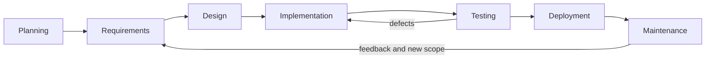

### Delivery timeline

Dates come from the git history.

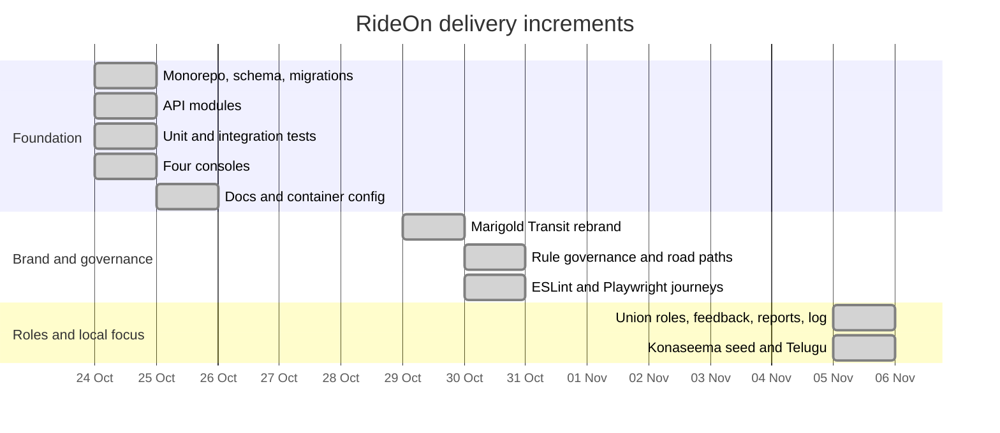

| SDLC phase | Main outputs | Where to find them |
|---|---|---|
| Planning | Goals, stakeholders, scope, risks | [Section 2](#2-planning) |
| Requirements | Functional and non-functional requirements | [Section 3](#3-requirements) |
| Design | Architecture, data model, state machines, sequences | [Sections 4](#4-design) and [5](#5-sequence-diagrams) |
| Implementation | Source code, migrations, seed, conventions | `apps/`, [Section 6](#6-implementation) |
| Testing | Unit, integration, component and browser suites | `apps/*/test`, `e2e/`, [Section 7](#7-testing) |
| Deployment | Build, Dockerfiles, Compose, release steps | [Section 8](#8-deployment), [deployment guide](../docs/deployment.md) |
| Maintenance | Operations, known limitations, roadmap | [Section 9](#9-maintenance-and-operations) |

---

## 2. Planning

### Problem

Auto-rickshaw drivers and their unions in small towns lack tools of their own. Fares are negotiated ride by ride, stands and queues are run informally, and driver unions have no shared record of members, decisions or money. Passengers cannot see a fare before travelling.

### Product goals

| # | Goal |
|---|---|
| G1 | Let a local driver union run its own network: members, stands, routes and fares |
| G2 | Show passengers a locked fare before they travel, with no algorithmic surge |
| G3 | Show drivers every fare and every deduction, trip by trip |
| G4 | Record every decision permanently, so governance can be checked |
| G5 | Work in the local language, on a phone, starting from pincode 533211 |

### Stakeholders

| Stakeholder | Interest |
|---|---|
| Passengers | A fair, safe, predictable ride |
| Drivers | Respect, fair turns at the stand, transparent earnings |
| Local admins and union officers | Control of their own union's operations and data |
| Platform owner (super admin) | Onboarding unions, verification, fees, oversight |
| Trusted contacts of passengers | Read-only live view of a shared trip |

### Scope

**In scope:** regular autos, shared-auto seats on scheduled routes, driver onboarding and verification, fare and rule governance, union console with delegated roles, driver fare feedback, reports, statements, complaints, support and SOS, activity and audit logs, English, Telugu and Hindi.

**On hold by the owner's decision:** a real payment gateway and SMS delivery. Cash works end to end, and a clearly labelled mock checkout exercises the online path in development.

### Risk register

| Risk | Impact | Mitigation in the product |
|---|---|---|
| Two drivers accept one trip | Trust loss | Transactional accept with conditional updates and a version check |
| Seats oversold | Passengers stranded | Row lock, unique active-seat key and a `CHECK` constraint |
| One union reads another's data | Privacy breach | URL-scoped queries; out-of-scope records return `404` |
| A delegate escalates their own rights | Governance failure | Limits re-applied on every read in `assignmentPermissions()` |
| Stolen refresh token | Account takeover | Rotation with reuse detection; the whole session family is revoked |
| Forged payment confirmation | Financial loss | Paid status set only by a signed webhook with a matching amount |
| Map providers rate-limit or fail | Booking blocked | Labelled straight-line estimate, manual address entry, geocoding cache |
| Super admin holds fare-vote rights | Union independence questioned | Recorded and visible; revisit before unions rely on the vote as independent |

---

## 3. Requirements

### Functional requirements

| ID | Requirement | Primary role |
|---|---|---|
| FR-01 | Register and sign in by mobile number or email; recover a password | All |
| FR-02 | Browse published fares and routes without an account | Public |
| FR-03 | Get a server-priced quote, valid for 10 minutes, and book a regular auto | Passenger |
| FR-04 | Hold and confirm shared-auto seats on a scheduled departure | Passenger |
| FR-05 | Track a trip live, share it with a trusted contact, raise an emergency alert | Passenger |
| FR-06 | Rate a driver and report a problem on a trip | Passenger |
| FR-07 | Register a licence, upload documents, apply to a union, register a vehicle | Driver |
| FR-08 | See exactly why the driver can or cannot go online | Driver |
| FR-09 | Go online, join a stand queue, accept offers, start with the passenger's PIN, complete | Driver |
| FR-10 | Run shared departures with a manifest and PIN boarding | Driver |
| FR-11 | See earnings with every deduction | Driver |
| FR-12 | Give feedback and suggested prices on union fares, and read the reply | Driver |
| FR-13 | Approve drivers, review documents, approve vehicles and set seat capacity | Local admin, Reporter |
| FR-14 | Add or delete pickup and drop points, routes and schedules | Local admin |
| FR-15 | Propose fare and rule changes, vote, and publish them as new versions | Local admin, Approver |
| FR-16 | Edit union master data: name, logo, colour, contacts, pincode | Local admin |
| FR-17 | Delegate roles and switch individual permissions on or off | Local admin |
| FR-18 | Prepare, refresh, edit, publish and export reports | Reporter |
| FR-19 | Manage the live stand queue, departures, bookings and complaints | Operator |
| FR-20 | Create unions, give them access, verify drivers, set fees and fare caps | Super admin |
| FR-21 | Assign platform and union roles to any registered person | Super admin |
| FR-22 | Log every API request locally and keep decisions in an append-only audit log | System |

### Non-functional requirements

| ID | Category | Requirement | How it is met |
|---|---|---|---|
| NFR-01 | Correctness | No double accept and no overselling under concurrency | Transactions, row locks, unique indexes; race tests |
| NFR-02 | Money | No floating-point money | Integer paise; fares round to the rupee as a shown line item |
| NFR-03 | Security | Sessions can be ended immediately | Live session check and role reload on each request |
| NFR-04 | Privacy | Minimal personal data exposure | First names only across parties, no phone sharing, driver location deleted when offline |
| NFR-05 | Auditability | Decisions cannot be altered | Database triggers reject `UPDATE` and `DELETE` on `audit_logs` and `fare_history` |
| NFR-06 | Resilience | Booking works without WebSockets or routing | Polling fallback; labelled distance estimate |
| NFR-07 | Accessibility and devices | Usable by keyboard and on phones | Labelled form controls, responsive layouts, mobile tab bar |
| NFR-08 | Localisation | New language without component changes | Dictionary files with English fallback |
| NFR-09 | Maintainability | Business rules testable in isolation | Pure fare engine, state machine and fee split modules |

---

## 4. Design

### 4.1 System context

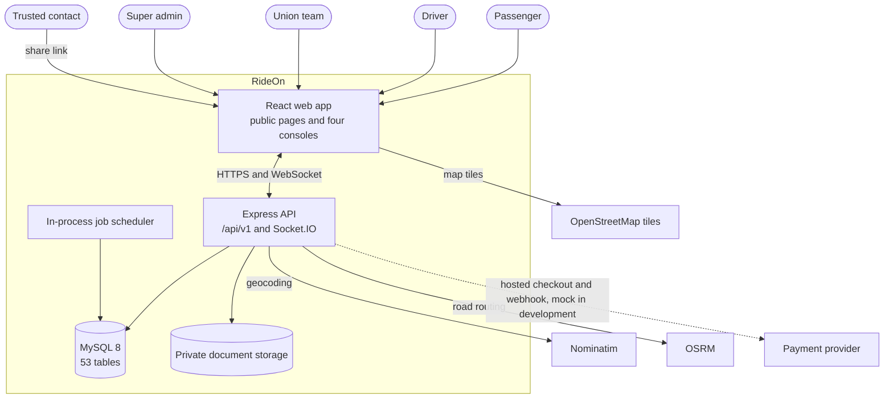

Three rules shape the system:

- **The database is the single source of truth.** All users, unions, fares, bookings, payments and audit records live in one MySQL database.
- **The API is authoritative.** The web app never computes a price it charges, never decides a state transition and never supplies a trusted role, fare or amount.
- **Real time is an enhancement.** Socket.IO pushes updates, while every screen also polls, so the booking flow keeps working without a WebSocket.

### 4.2 Backend modules

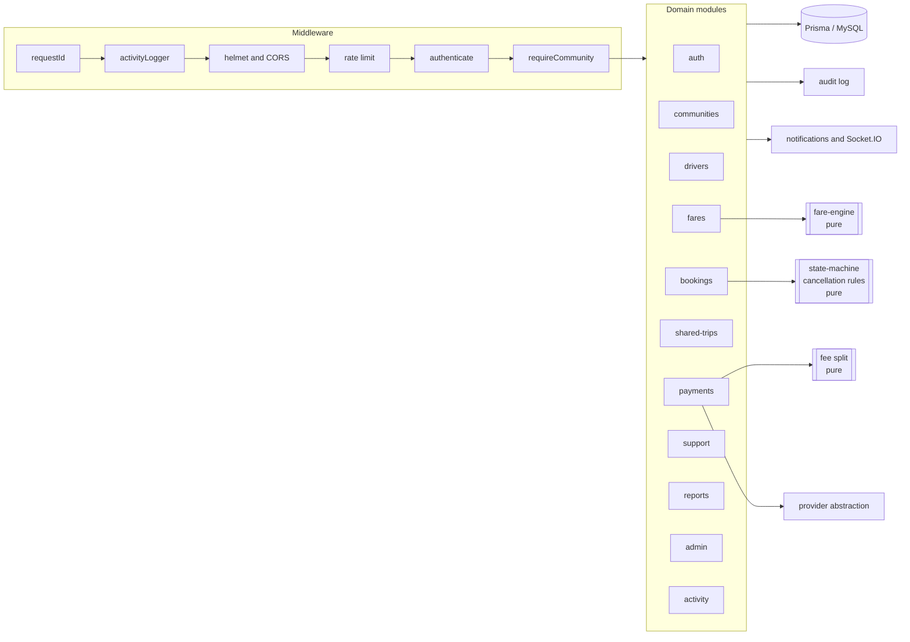

### 4.3 Data model

There are 53 tables. The core relationships are below; every table is listed in the [database design](../docs/database-design.md).

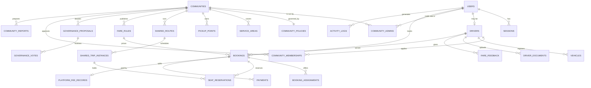

### 4.4 Booking state machines

The tables in `apps/api/src/modules/bookings/state-machine.ts` are exhaustive: any transition not listed is rejected with `409 INVALID_TRANSITION`.

**Regular auto**

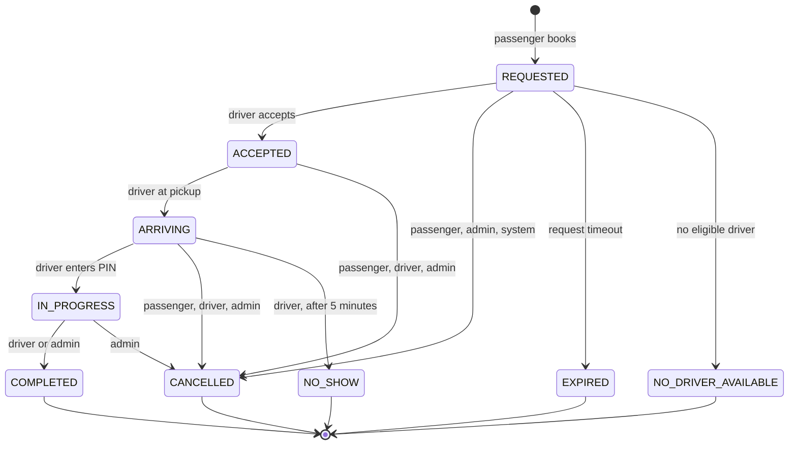

**Shared seat**

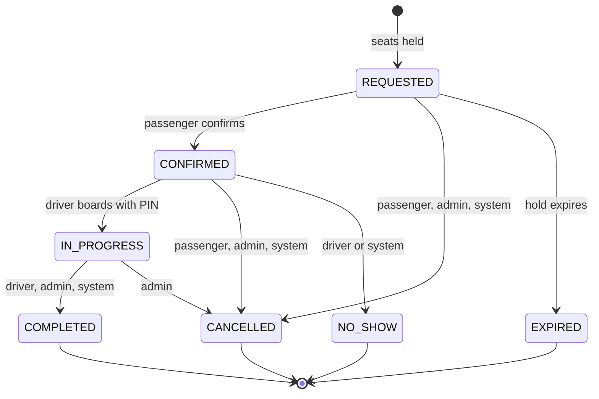

**Governance proposal**

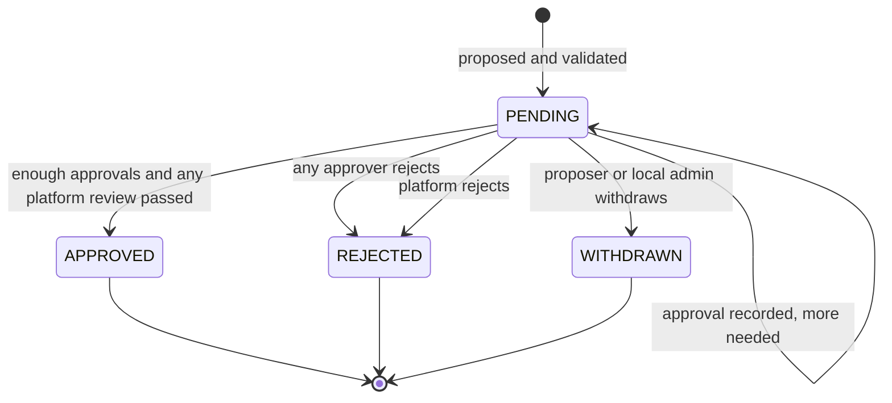

### 4.5 Access control

Access has two layers. **System roles** open a console. **Union roles** apply inside one union only. A local admin may give a delegate a custom list of permissions, except the two that stay with local admins.

| Permission (`community.…`) | Local admin | Reporter | Approver | Operator |
|---|---|---|---|---|
| `view` | Yes | Yes | Yes | Yes |
| `profile.edit` | Yes | | | |
| `policy.edit` (local admin only) | Yes | | | |
| `admins.manage` (local admin only) | Yes | | | |
| `members.manage` | Yes | Yes | | |
| `drivers.manage` | Yes | Yes | | |
| `vehicles.manage` | Yes | | | |
| `areas.manage` | Yes | Yes | | |
| `routes.manage` | Yes | | | |
| `fares.propose` | Yes | | | |
| `fares.approve` | Yes | | Yes | |
| `feedback.manage` | Yes | | Yes | |
| `queue.manage` | Yes | | | Yes |
| `bookings.view` | Yes | Yes | Yes | Yes |
| `complaints.manage` | Yes | | | Yes |
| `announcements.manage` | Yes | | | |
| `reports.manage` | Yes | Yes | | |
| `statements.view` | Yes | Yes | Yes | |
| `audit.view` | Yes | Yes | Yes | |

The super admin holds all of these in every union, plus the platform permissions. The source of truth is `apps/api/src/modules/auth/permissions.ts`.

### 4.6 Fare and fee calculation

Regular fare: base fare covers the base distance, then a per-km rate applies. The minimum fare, the night surcharge (in IST) and waiting charges after the free minutes come from the union's published rule, and the total rounds to the rupee.

The fee split is calculated in integer paise. The platform fee is capped, and the driver absorbs rounding.

**Worked example with the demo fare table:** a 5.6 km daytime trip costs ₹30 + (3.6 km × ₹15) = **₹84**.

| Line | Rule in the demo seed | Amount |
|---|---|---|
| Fare | | ₹84.00 |
| Platform fee | 5%, capped at ₹20 | ₹4.20 |
| Union fee | 2% | ₹1.68 |
| **Driver keeps** | | **₹78.12** |

These percentages and fares are seed data for demonstration. Real values are set by the platform's fee schedule and each union's approved fare table.

### 4.7 Background jobs

| Job | Interval | Purpose |
|---|---|---|
| dispatch-sweep | 5 s | Expire unanswered offers and offer the next batch |
| expire-requests | 15 s | Move `REQUESTED` past its timeout to `EXPIRED` |
| expire-seat-holds | 20 s | Release unconfirmed shared holds |
| generate-departures | 30 min | Materialise schedules into departures for the next 3 days |
| departure-reminders | 1 min | Notify passengers 30 minutes before departure |
| purge-locations | 5 min | Delete stale driver locations and take vanished drivers offline |
| purge-activity | 6 hours | Delete activity log rows older than 90 days |

---

## 5. Sequence diagrams

Each diagram follows the order of calls in the service code. Every API request also passes through the pipeline in [5.3](#53-authorised-request-pipeline), which later diagrams leave out for clarity.

### 5.1 Sign-in

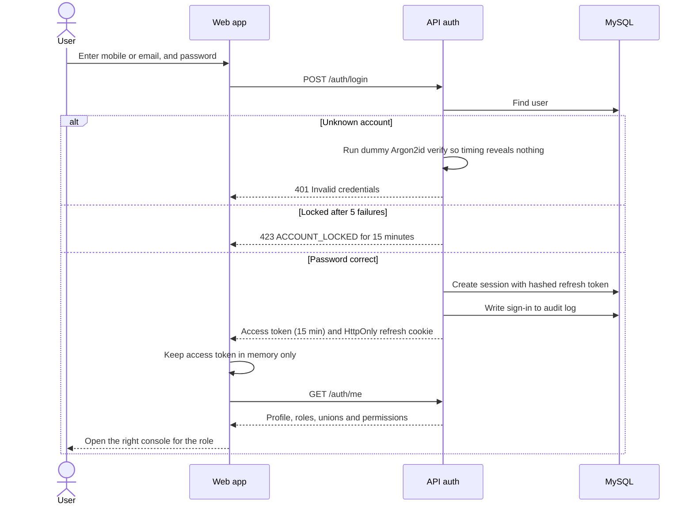

### 5.2 Token refresh and reuse detection

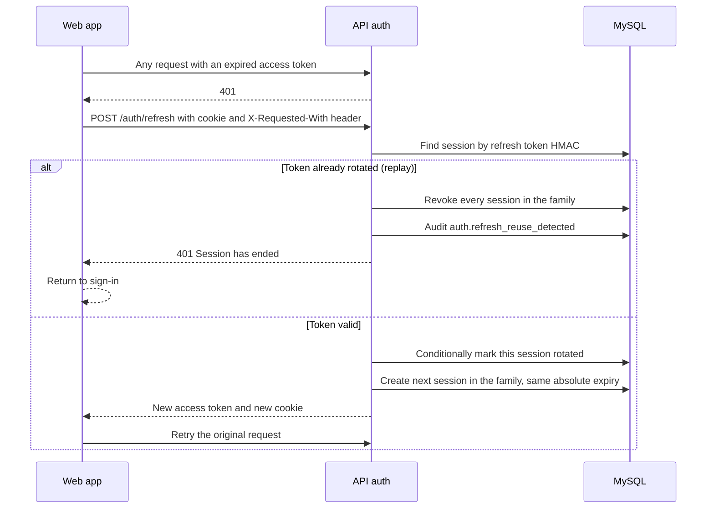

### 5.3 Authorised request pipeline

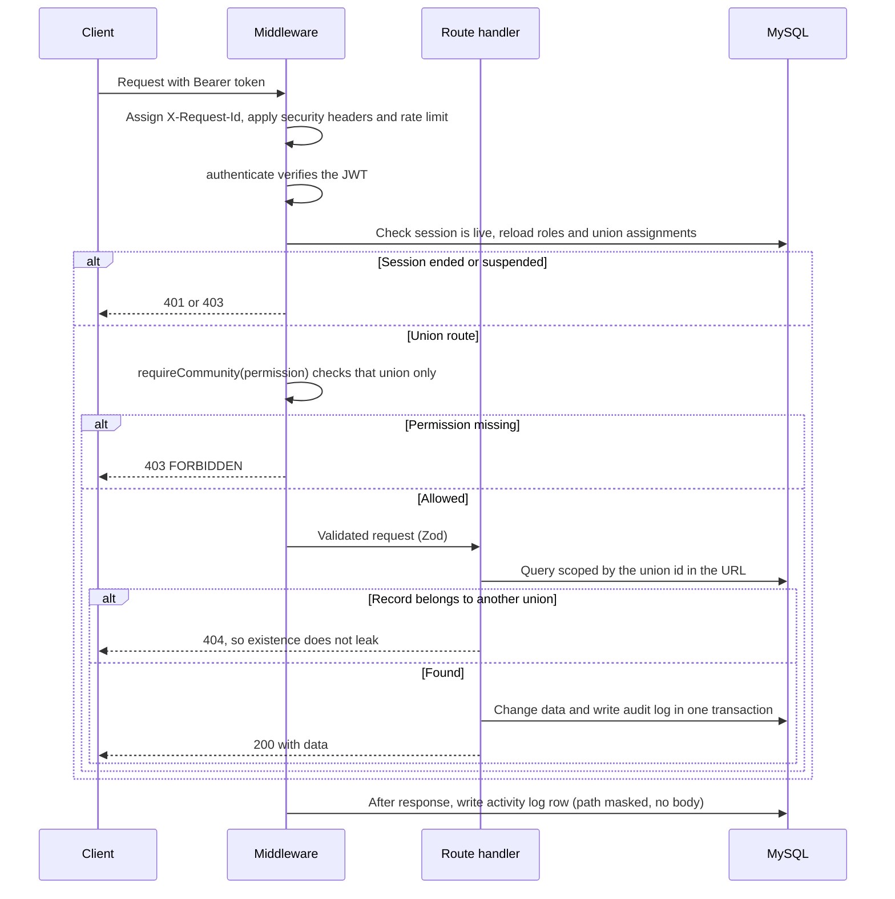

### 5.4 Driver onboarding

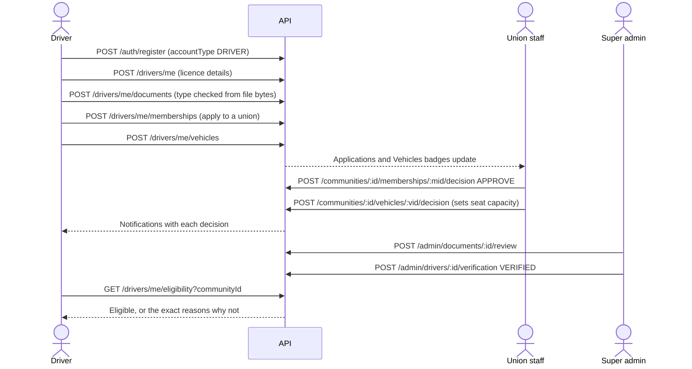

### 5.5 Quote and regular booking

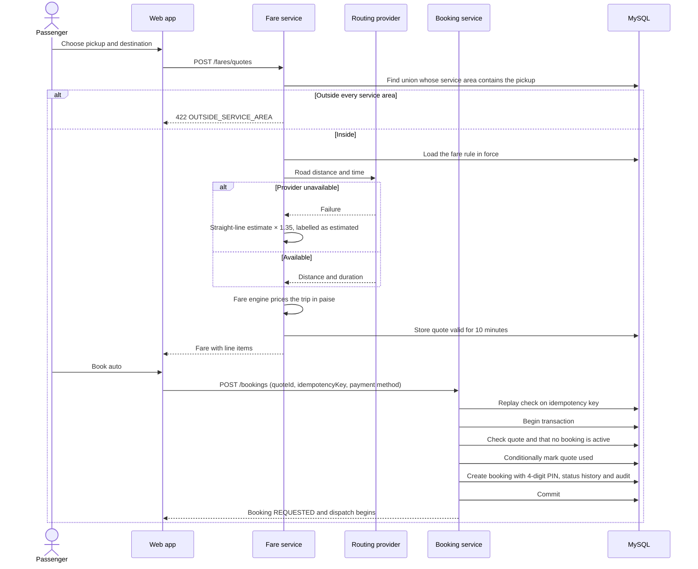

### 5.6 Dispatch and accepting a trip

Offers go out in batches of up to 3. Candidates are online, verified, approved members with a location under 5 minutes old, within 6 km of the pickup. Drivers queued at a stand within 500 m come first, in queue order. Other drivers follow by distance.

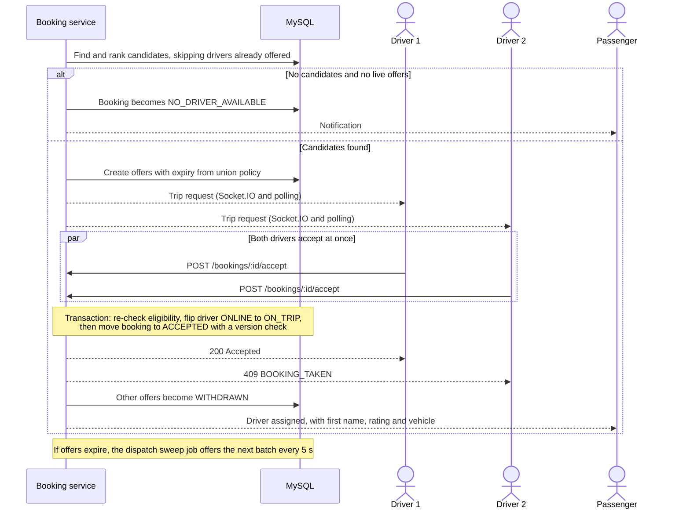

### 5.7 Trip progress and cash

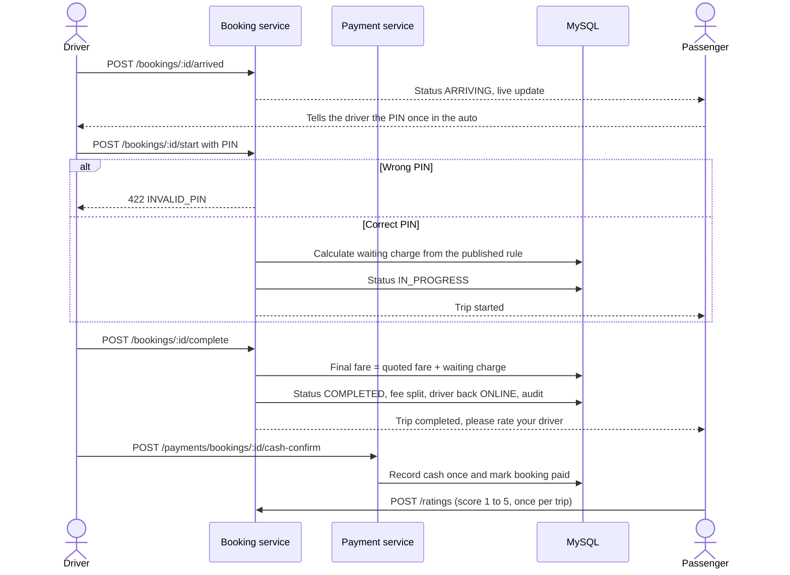

### 5.8 Online payment (mock provider in development)

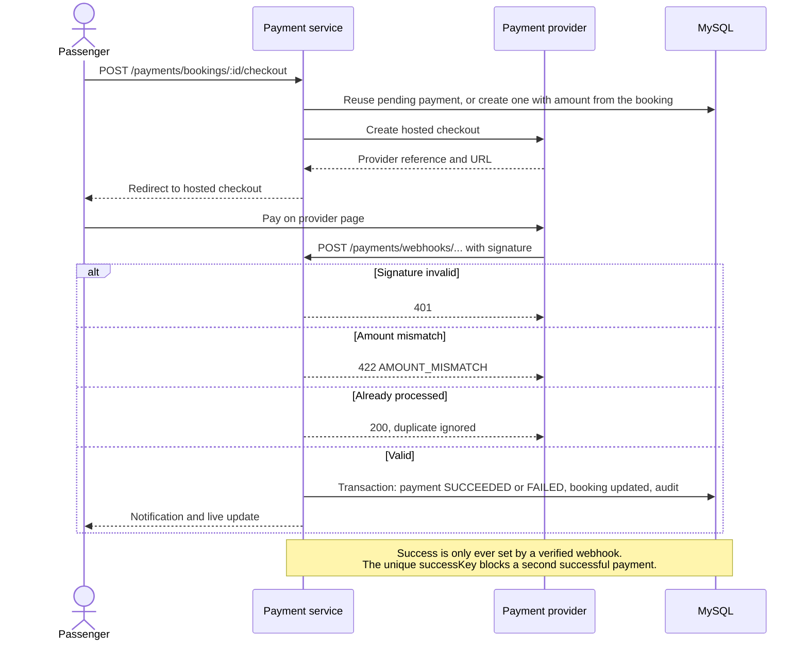

### 5.9 Shared seat hold under concurrency

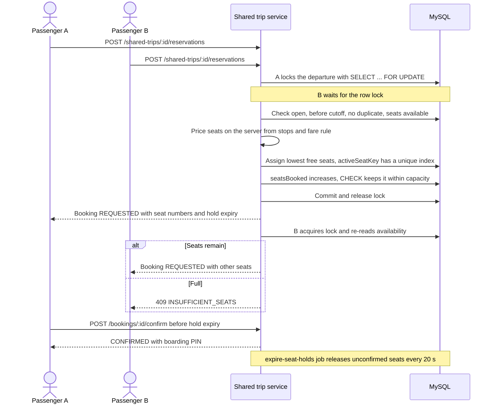

An integration test fires 10 passengers at a 3-seat departure. Exactly 3 succeed, on seats 1 to 3.

### 5.10 Running a shared departure

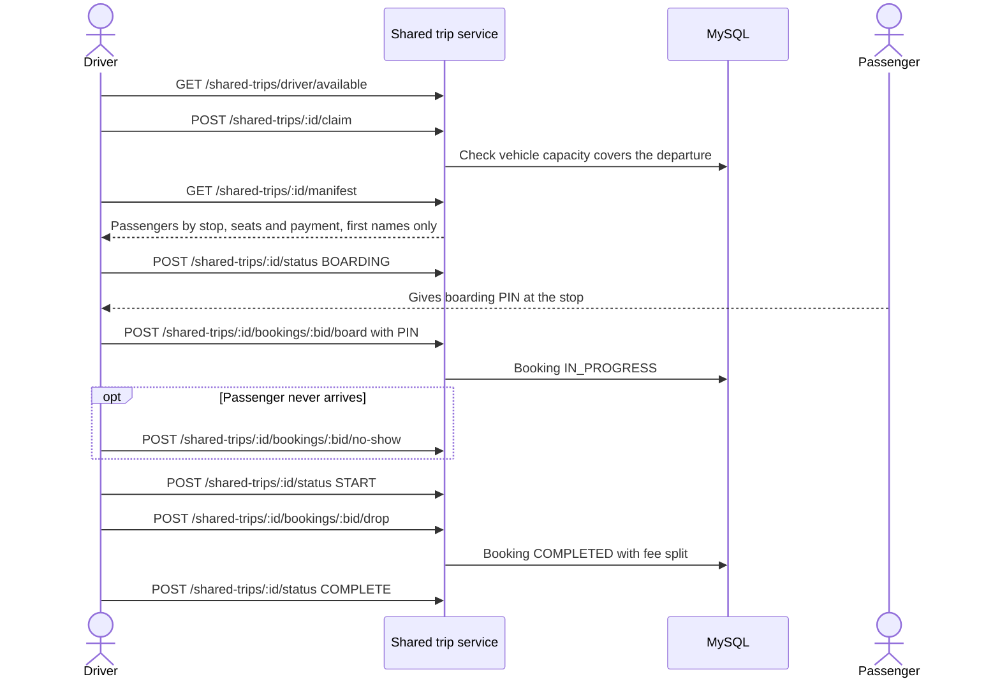

### 5.11 Fare governance

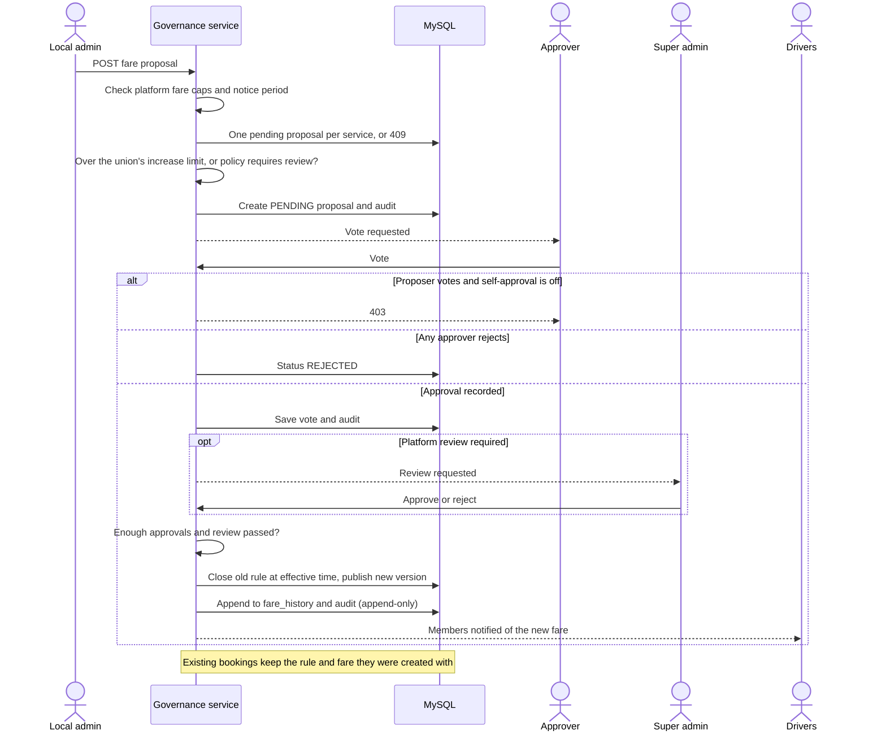

Rule changes (cancellation fee, approval mode and similar) follow the same path as `POLICY_CHANGE` proposals. Direct edits return `422 GOVERNANCE_REQUIRED`. Only operational timeouts stay directly editable by a local admin.

### 5.12 Driver fare feedback

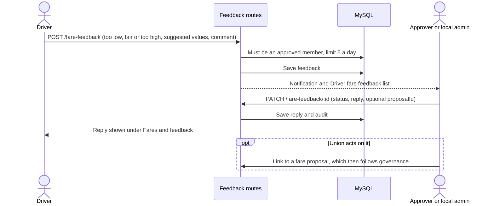

### 5.13 Giving a union access and delegating roles

```mermaid
sequenceDiagram
    actor S as Super admin
    participant Ad as Admin API
    participant C as Union API
    participant DB as MySQL
    actor L as Local admin
    actor R as New delegate
    S->>Ad: POST /admin/communities (create union)
    S->>Ad: POST /admin/users/:id/community-roles LOCAL_ADMIN
    Ad->>DB: Create assignment and audit
    L->>C: PATCH /communities/:id (master data), POST /logo
    L->>C: POST /communities/:id/admins (mobile number, role)
    C->>C: assertCanManageRole, only roles below local admin
    C->>DB: Create assignment and audit
    L->>C: PATCH /admins/:adminId with custom permissions
    C->>C: Keep only DELEGABLE_PERMISSIONS
    C->>DB: Save list and audit
    R->>C: GET /communities/:id/console
    C->>C: assignmentPermissions() re-applies limits on every read
    C-->>R: Permissions, so navigation shows only allowed pages
```

### 5.14 Safety: trip sharing and emergency

```mermaid
sequenceDiagram
    actor P as Passenger
    participant B as Booking service
    participant DB as MySQL
    actor T as Trusted contact
    actor St as Union and platform staff
    P->>B: POST /bookings/:id/share
    B->>DB: Create or reuse token, valid 12 hours
    B-->>P: Link /track/token
    P-->>T: Sends the link
    T->>B: GET /track/:token
    B-->>T: Limited trip fields, no account needed
    P->>B: POST /bookings/:id/sos
    B->>DB: Transaction: SOS trip event and URGENT safety ticket
    B-->>St: Urgent notification with link
    B->>DB: Audit safety.sos_raised
    B-->>P: Ticket reference and emergency number 112
```

### 5.15 Preparing a union report

```mermaid
sequenceDiagram
    actor Rp as Reporter
    participant Rt as Reports routes
    participant DB as MySQL
    Rp->>Rt: POST /communities/:id/reports (title, from, to)
    Rt->>DB: Calculate metrics for the period
    Rt->>DB: Save DRAFT with metrics snapshot
    Rt-->>Rp: Report id
    Rp->>Rt: GET /reports/:reportId
    opt Data has changed
        Rp->>Rt: POST /reports/:reportId/refresh
        Rt->>DB: Recalculate the draft
    end
    Rp->>Rt: PATCH /reports/:reportId with notes
    Rp->>Rt: PATCH /reports/:reportId status PUBLISHED
    Rt->>DB: Freeze title and figures, notes stay editable
    Rp->>Rt: GET /reports/:reportId/export.csv
```

---

## 6. Implementation

### Technology stack

| Layer | Technology |
|---|---|
| Web | React 19, TypeScript, Vite, Tailwind CSS 4, React Router 7, TanStack Query, React Hook Form with Zod, Leaflet with OpenStreetMap, Socket.IO client |
| API | Node.js 24 LTS, TypeScript, Express 5, Zod, Prisma 6, Socket.IO, Argon2id, JWT with rotating refresh cookies, pino |
| Database | MySQL 8.4 (`utf8mb4`, UTC) |
| Tests | Vitest, Supertest against real MySQL, Testing Library, Playwright |
| Quality | TypeScript strict mode, ESLint with typescript-eslint and React Hooks rules |

### Repository layout

```text
apps/api/prisma      Schema, 4 migrations, development seed
apps/api/src         config, middleware, modules, services, jobs, sockets, utils
apps/api/test        Unit and integration suites
apps/web/src         app, layouts, components, features, pages, hooks, services, i18n
e2e/                 Playwright journeys on an isolated stack
docs/                Architecture, database, API, security, deployment references
Documentation/       This document, the user manual and the presentation
scripts/             Local MySQL start and stop helpers
```

### Conventions

- **Money** is integer paise. **Time** is ISO-8601 UTC, with IST applied to night fares and display.
- **API responses** are `{ data, meta? }` or `{ error: { code, message, details?, requestId } }`.
- **Business rules that must be exact** live in pure modules with no database access: `fare-engine.ts`, `state-machine.ts`, `cancellation.ts` and `fees.ts`.
- **Services accept a Prisma client or transaction**, so the same function can run inside a caller's transaction.
- **Idempotency:** booking and seat-hold requests carry a key, and replays return the original booking.
- **Web data access** goes through `useApi`, `useApiPage` and `useAction`, with `QueryState` for loading, empty and error states.
- **Translations** use `useT()` with dictionaries in `apps/web/src/i18n`.
- **Permissions in the UI** come from the API through `useCommunity().can(...)`. The API enforces the same rules, so hiding a page is never the only guard.

### Key configuration

Copy `.env.example` to `.env`. The file documents each setting.

| Setting | Purpose |
|---|---|
| `DATABASE_URL`, `TEST_DATABASE_URL` | Main and test databases; the test database name must end in `test` |
| `JWT_ACCESS_SECRET`, `JWT_REFRESH_PEPPER`, `PAYMENT_WEBHOOK_SECRET` | Secrets, generated for each environment |
| `WEB_ORIGIN`, `TRUST_PROXY`, `COOKIE_SECURE` | CORS, client IP handling and cookie security |
| `UPLOAD_DIR` | Private document storage, outside any web root |
| `GEOCODING_*`, `ROUTING_*`, `VITE_TILE_*` | Map providers |
| `PAYMENT_PROVIDER` | The API refuses to start with `mock` in production |
| `JOBS_ENABLED` | Turn jobs off on all but one instance when scaling out |

---

## 7. Testing

### Strategy

```mermaid
flowchart TB
    E[Browser journeys: 18<br/>Playwright, real Chrome, isolated stack]
    I[API tests: 98<br/>unit and integration against real MySQL]
    W[Web tests: 16<br/>Vitest and Testing Library]
    S[Static checks<br/>TypeScript strict and ESLint]
    E --> I --> W --> S
```

Integration tests use a real MySQL database rather than mocks, because the most important guarantees (row locks, unique indexes, triggers and transactions) only exist in the database.

### Latest recorded results (5 November 2026)

| Suite | Command | Result |
|---|---|---|
| API unit and integration | `npm test` | 98 passed |
| Web components and journeys | `npm test` | 16 passed |
| Browser journeys | `npm run test:e2e` | 18 passed |
| Type check, lint, production build | `npm run typecheck`, `npm run lint`, `npm run build` | Pass |

After the last small change (the development login prefill), the public and role journeys were rerun and 8 of 8 passed. See the [build status](../BUILD_STATUS.md) for the detailed record.

### Test suites

| Location | Focus |
|---|---|
| `apps/api/test/unit/fare-engine.test.ts` | Fare calculation, night surcharge, waiting, shared pricing, integer money |
| `apps/api/test/unit/business-rules.test.ts` | State transitions, cancellation rules, fee split, fare validation |
| `apps/api/test/unit/permissions.test.ts` | Role scopes, union isolation, revoked roles |
| `apps/api/test/integration/auth.test.ts` | Registration, tokens, refresh reuse, lockout, reset |
| `apps/api/test/integration/regular-booking.test.ts` | Quotes, idempotency, dispatch, concurrent accept, PIN, webhooks |
| `apps/api/test/integration/shared-booking.test.ts` | Seat holds, 10 passengers racing for 3 seats, boarding, expiry |
| `apps/api/test/integration/governance.test.ts` | Proposals, votes, caps, platform review, append-only history |
| `apps/api/test/integration/isolation.test.ts` | Cross-union access, object-level access, admin protection |
| `apps/api/test/integration/union-admin.test.ts` | Union roles, delegation, master data, feedback, reports, activity log |
| `apps/web/src/test/` | Formatting, API client refresh behaviour, route guards, forms |
| `e2e/specs/01` to `06` | Public pages, full ride in two sessions, shared seat, governance, roles, union administration |

### Requirements traceability

| Requirement | Verified by |
|---|---|
| FR-01 Sign-in and recovery | `auth.test.ts`, `journeys.test.tsx`, e2e 01 |
| FR-02 Public fares | e2e 01 |
| FR-03 Regular booking | `regular-booking.test.ts`, e2e 02 |
| FR-04 Shared seats | `shared-booking.test.ts`, e2e 03 |
| FR-07, FR-08 Driver onboarding, eligibility | `regular-booking.test.ts`, `isolation.test.ts` |
| FR-09 Trip flow with PIN | `regular-booking.test.ts`, e2e 02 |
| FR-12 Fare feedback | `union-admin.test.ts`, e2e 06 |
| FR-15 Governance | `governance.test.ts`, e2e 04 |
| FR-16, FR-17 Master data and delegation | `union-admin.test.ts`, e2e 06 |
| FR-18 Reports | `union-admin.test.ts`, e2e 06 |
| FR-21, FR-22 Role assignment and activity log | `union-admin.test.ts`, e2e 06 |
| NFR-01 Concurrency | `regular-booking.test.ts`, `shared-booking.test.ts` |
| NFR-05 Append-only records | `governance.test.ts` |

### Running tests

MySQL must be running. The browser suite creates its own database, API and web server, so it never touches development data.

```bash
npm test
```

```bash
npm run test:e2e
```

---

## 8. Deployment

```mermaid
flowchart LR
    U([Users]) -->|HTTPS| N[nginx or CDN<br/>static web build]
    N -->|/api and /socket.io| A[Node.js API]
    A --> M[(MySQL 8)]
    A --> F[(Encrypted document storage)]
    A --> Mp[Hosted map providers]
    A -.-> G[Payment gateway, on hold]
```

The web app and API must share one origin, so the `SameSite=Strict` refresh cookie works.

### Release steps

1. Back up the database.
2. Run `npm run db:migrate`, which uses `prisma migrate deploy`. Never run `migrate dev` or `reset` in production.
3. Deploy the API, then the web build.
4. Check `GET /api/v1/health`, which returns `503` if the database is unreachable.

### Before going live

- Set strong secrets, `NODE_ENV=production`, `COOKIE_SECURE=true` and a correct `TRUST_PROXY`.
- Integrate a payment gateway and an SMS or email provider.
- Use hosted or self-hosted tile, geocoding and routing providers.
- Do not run the demo seed. Create the first super admin through a controlled script.
- Set up encrypted backups of MySQL and document storage.
- Get a legal review of fare caps, data retention and consent texts.

The full [security checklist](../docs/security.md#production-checklist) and [deployment guide](../docs/deployment.md) have the details. `docker-compose.yml` has not been run, because Docker was not available during development, so verify it in your environment first.

---

## 9. Maintenance and operations

### Monitoring

| What | How |
|---|---|
| Availability | `GET /api/v1/health` |
| Application logs | JSON (pino) on stdout, with secrets and personal data redacted |
| Job failures | `"Job failed"` log lines |
| Database contention | MySQL lock waits, because seat reservations rely on row locks |
| Who did what | **Activity log** (requests, 90 days) and **Audit log** (decisions, permanent) in the platform console |
| Tracing one request | `X-Request-Id` on every response, stored in the activity log |

### Backups

Take daily MySQL dumps plus binary logs for point-in-time recovery, and back up uploaded documents separately.

### Scaling path

| Limit today | Next step |
|---|---|
| Socket.IO rooms and rate limits are in memory | Redis adapter and store |
| Jobs run in the API process | `JOBS_ENABLED=false` on all but one instance, or a worker |
| Polygons checked in application code | MySQL spatial columns and indexes for many cities |
| Documents on local disk | Encrypted S3-compatible storage |
| Driver locations in MySQL | Redis GEO with expiry for large fleets |

### Known limitations

| Item | Status |
|---|---|
| Payment gateway | On hold. Cash works; mock checkout is development only |
| SMS and email | On hold. Notifications are in-app; a production password reset cannot deliver its code until a provider is added |
| Telugu | Machine-written. Needs review by a native speaker |
| Admin consoles | English only. Telugu and Hindi cover the public site, passenger flow and driver console |
| Docker Compose | Not run |
| Cancellation fees on cash trips | Recorded, not collected |
| Super admin fare votes | Super admins can vote on fares at the owner's request; revisit before unions rely on the vote as independent |
| Auth rate limit | `/auth/refresh` shares the login limit of 30 per 15 minutes per IP, and every full page load refreshes. Heavy reloading, or many people behind one IP, can hit `429 RATE_LIMITED`. Consider a separate, higher limit for refresh before launch |

### Roadmap

1. Choose and integrate a payment gateway and an SMS provider.
2. Run the Compose stack, then deploy staging with hosted map providers.
3. Replace the demo seed with a production bootstrap for the first super admin and pilot union.
4. Run a pilot with one real union in pincode 533211, and review fare caps, policy defaults and consent texts with them.
5. Have Telugu reviewed by a native speaker.
6. Run lint, unit and browser tests in CI.

---

## 10. Glossary

| Term | Meaning |
|---|---|
| Union, community | A local auto drivers' association. The code says `community`; the screens mostly say union |
| Stand | A pickup point where drivers queue in arrival order |
| Shared auto | A scheduled route where passengers book individual seats |
| Departure | One scheduled run of a shared route (`shared_trip_instances`) |
| Quote | A server-priced fare stored for 10 minutes and required to book |
| Start PIN | A 4-digit code the passenger gives the driver to begin a trip |
| Fare rule | A versioned, published fare table |
| Proposal | A requested change to a fare or rule, decided by votes |
| Paise | 1/100 of a rupee; all money is stored in paise |
| Bps | Basis points; 500 bps is 5% |
| IST | Indian Standard Time, UTC+05:30 |
