# RideOn user manual

**Your city. Your people. Your ride.**

This manual explains how to use RideOn, organised by role. You only need the sections for your own role.

| Your role | What you do | Go to |
|---|---|---|
| **Passenger** | Book autos and shared seats | [Passenger guide](#3-passenger-guide) |
| **Driver** | Take trips and see your earnings | [Driver guide](#4-driver-guide) |
| **Operator** | Run the stand queue, departures and complaints | [Operator guide](#5-operator-guide) |
| **Approver** | Vote on fares and answer driver feedback | [Approver guide](#6-approver-guide) |
| **Reporter** | Prepare reports, approve drivers, set service areas | [Reporter guide](#7-reporter-guide) |
| **Local admin** | Run your whole union | [Local admin guide](#8-local-admin-guide) |
| **Super admin** | Run the whole platform | [Super admin guide](#9-super-admin-guide) |

> The screenshots show sample data for the Ainavilli area. Union names, people, fares and fees in them are examples, not real records. Your fares come from your own union.

## Contents

1. [Getting started](#1-getting-started)
2. [Who can do what](#2-who-can-do-what)
3. [Passenger guide](#3-passenger-guide)
4. [Driver guide](#4-driver-guide)
5. [Operator guide](#5-operator-guide)
6. [Approver guide](#6-approver-guide)
7. [Reporter guide](#7-reporter-guide)
8. [Local admin guide](#8-local-admin-guide)
9. [Super admin guide](#9-super-admin-guide)
10. [Troubleshooting](#10-troubleshooting)
11. [Glossary](#11-glossary)

---

## 1. Getting started

### Check fares without an account

Open **Fares** at the top of the home page to see each union's published fares, service areas, stands and shared routes.

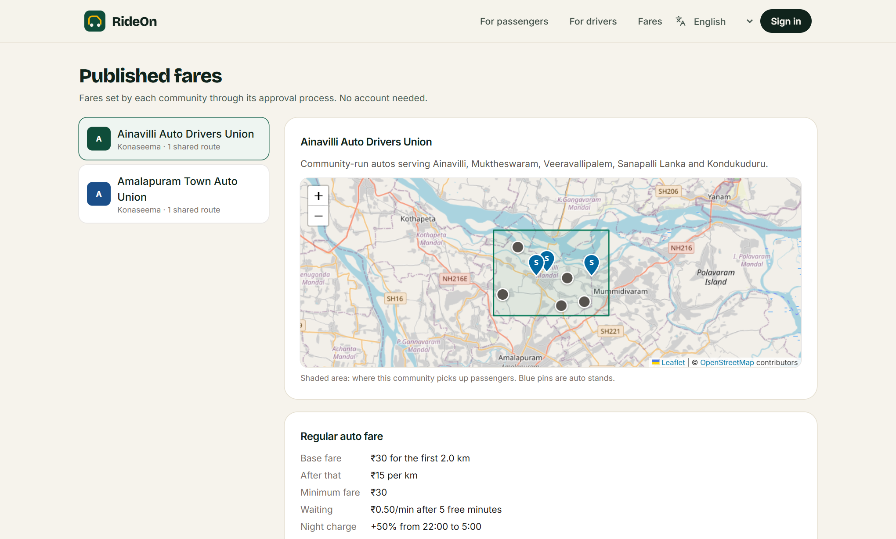

### Create an account

1. Choose **Book a ride** or **Drive with your community** on the home page, or **Sign in** and then **Create an account**.
2. Enter your **Full name**, **Mobile number** and a **Password**. The password needs at least 10 characters, with letters and digits. **Email** is optional.
3. Tick **I agree to the Terms of Service and Privacy Policy**.
4. Select **Create account**.

Union team members register in the same way, then a local admin or super admin gives them a role using their mobile number.

### Sign in and sign out

1. Select **Sign in**.
2. Enter your **Mobile number or email** and your **Password**.
3. Select **Sign in**. RideOn opens the right screen for your role.

To sign out, use **Sign out** at the top of the page or the exit icon beside your name.

After 5 wrong passwords, the account locks for 15 minutes.

### Change the language

Use the language menu at the top of the page to choose **తెలుగు**, **English** or **हिन्दी**. Telugu and Hindi cover the public pages, the passenger screens and the driver console. Union and platform consoles are in English.

### Forgotten password

1. On the sign-in page, select **Forgot password?**.
2. Enter your **Mobile number or email** to request a reset code.
3. Enter the **Reset code** and a **New password**. Resetting signs you out on all devices.

> SMS delivery is not switched on yet, so a code cannot reach your phone by itself. Until it is, ask your platform administrator for help.

### Notifications

The bell at the top of the page shows your messages, such as a driver being assigned or a union replying to you. The **Live** dot in the driver and admin consoles means updates are arriving instantly. If it is off, pages still update every few seconds.

---

## 2. Who can do what

| Task | Passenger | Driver | Operator | Approver | Reporter | Local admin | Super admin |
|---|---|---|---|---|---|---|---|
| Book rides and shared seats | Yes | | | | | | Yes |
| Take trips, see earnings | | Yes | | | | | |
| Give feedback on union fares | | Yes | | | | | |
| Manage live queue and departures | | | Yes | | | Yes | Yes |
| Handle complaints and appeals | | | Yes | | | Yes | Yes |
| View bookings | | | Yes | Yes | Yes | Yes | Yes |
| Vote on fare and rule proposals | | | | Yes | | Yes | Yes |
| Answer driver fare feedback | | | | Yes | | Yes | Yes |
| View revenue statements and decision history | | | | Yes | Yes | Yes | Yes |
| Prepare and publish reports | | | | | Yes | Yes | Yes |
| Approve drivers, review their documents | | | | | Yes | Yes | Yes |
| Set service areas | | | | | Yes | Yes | Yes |
| Approve vehicles | | | | | | Yes | Yes |
| Add or delete points, routes and schedules | | | | | | Yes | Yes |
| Propose fare and rule changes | | | | | | Yes | Yes |
| Edit union profile and logo | | | | | | Yes | Yes |
| Publish announcements | | | | | | Yes | Yes |
| Give roles and permissions to the team | | | | | | Yes (roles below them) | Yes (all) |
| Change operational settings | | | | | | Yes | Yes |
| Create unions, verify drivers, set fees | | | | | | | Yes |

These are the defaults. A local admin can switch individual permissions on or off for each operator, approver and reporter, so your own menu may differ. You only ever see the pages you are allowed to use, and only for your own union.

---

## 3. Passenger guide

**Your promise: the freedom to travel your way.** You choose a whole auto or a single seat, and you see the fare before you travel.

### Book an auto

1. Open **Book**.
2. Set your **Pickup** by typing a place, selecting **Use my location**, or tapping the map.
3. Set your **Destination** in the same way. You can drag either pin to adjust it.
4. Select **See fare**. The fare and how it is worked out appear, along with the union that serves your area.
5. Under **Payment**, choose **Cash to driver**.
6. Select **Book auto**.

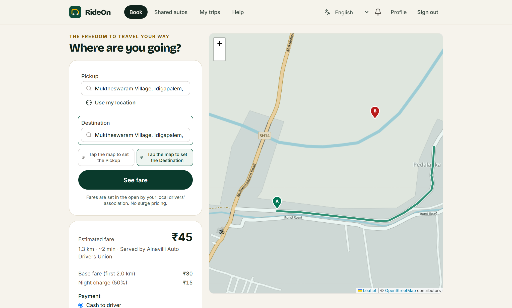

The fare is held for 10 minutes while you decide. Once you book, it is locked, apart from any waiting charge shown in your union's published fares.

> RideOn has no surge pricing. Your local union sets fares in the open. A night charge applies only if your union's published fare includes one.

### During your trip

Your trip page shows the status, your driver's first name, rating and vehicle number, and the driver's position on the map.

1. **Check the registration number** before you get in.
2. **Give your driver the Start PIN once you are in the auto.** The trip can't start without it, so don't share it earlier.
3. Pay the driver in cash at the end, if you chose cash.

Your phone number is never shared with the driver, and you won't see theirs.

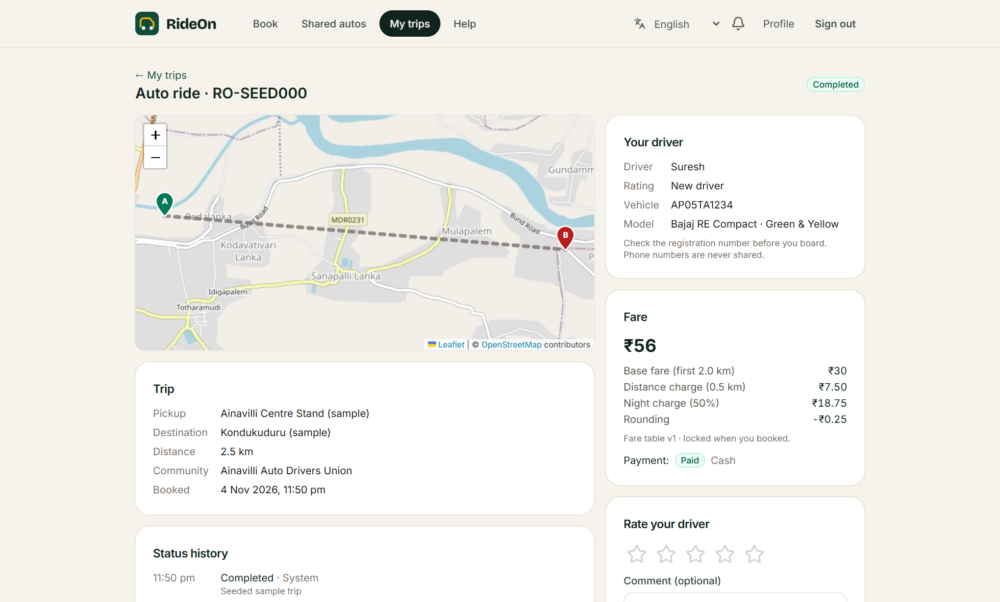

### Stay safe

| Feature | How to use it | What happens |
|---|---|---|
| **Share trip** | Select it on an active trip and send the link to someone you trust | They can follow your trip without an account for up to 12 hours |
| **Emergency** | Select it on your trip page and confirm | Union and platform staff get an urgent alert, and RideOn shows the emergency number, **112**. If you are in danger, call 112 directly |
| **Trusted contact** | Save a name and number under **Profile** | Keeps your contact details on your account |

### Book a shared auto seat

Shared autos run on fixed routes at set times, and you pay per seat.

1. Open **Shared autos**.
2. Choose the **Community** and **Route**.
3. Choose where to **Board at** and **Get off at**, and the number of **Seats** (up to 4).
4. Pick a departure, then select **Hold seats**.
5. Select **Confirm booking** before the hold ends, or the seats are released. Holds last 5 minutes unless your union has changed this.
6. Give the driver your boarding PIN when you get in.

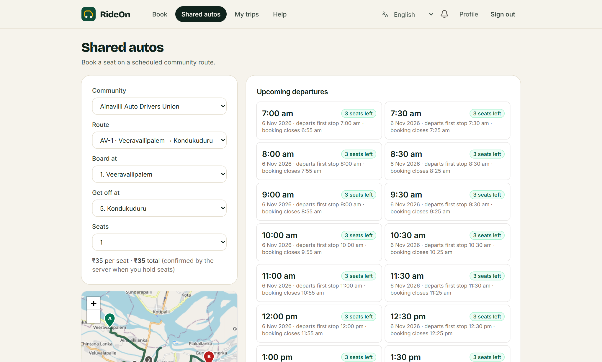

### Cancel a booking

Open the trip from **My trips**, select **Cancel booking** and enter a reason.

| Booking | When it is free | After that |
|---|---|---|
| Auto | Until a driver accepts, and for a short time afterwards (2 minutes by default) | Your union's cancellation fee applies (₹20 by default) |
| Shared seat | Until your route's cancellation cutoff before departure | Your union's cancellation fee applies, up to the fare |

You never pay a fee when the driver, union or platform cancels. A driver who waits 5 minutes at the pickup without finding you can mark a no-show, which can also carry the fee.

### After your trip

- **Rate your driver** from 1 to 5 stars on the trip page. You can rate each trip once.
- **Report a problem** on the trip page sends a complaint to the union that ran the trip. Your union reviews every complaint.
- **Help** is for general questions, incidents and safety concerns. It also lists your complaints and tickets.

---

## 4. Driver guide

**Your promise: respect for the people who move your city.** Fares come from your union, not an algorithm. You see every rupee of every trip.

### Before your first trip

You can go online only when all of these are done. **Profile & documents** has a **Ready to drive?** panel that tells you exactly what is missing.

1. **Create an account** and choose to drive.
2. Open **Profile & documents** and enter your **Driving licence number** and **Licence valid until** date.
3. **Upload your documents** as PDF, JPEG or PNG, up to 5 MB each: driving licence, vehicle RC, permit, insurance, ID proof and photo.
4. Under **Community membership**, choose your union in **Apply to** and send your application.
5. Under **Vehicles**, add your registration number, fuel, make, model, colour, permit and insurance details.
6. **Wait for approval:**
    - The platform verifies your identity and licence.
    - Your union approves your membership.
    - Your union approves your vehicle and sets its seat count.

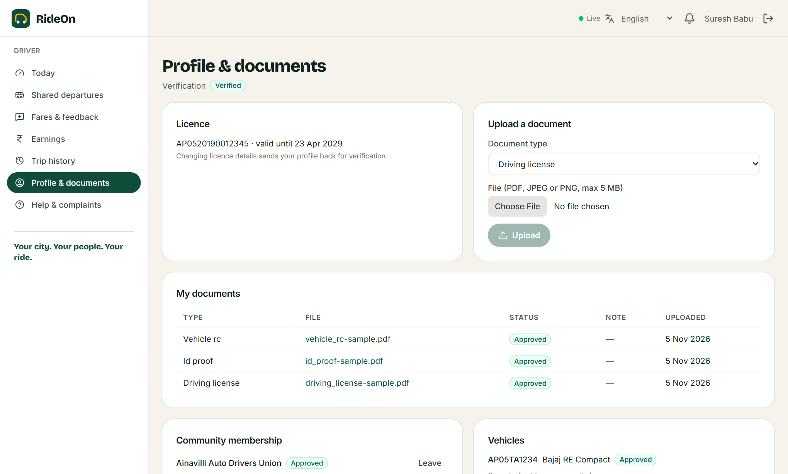

> Your documents are private. Only you, the platform and authorised staff of your union can open them, and every view is recorded. Keep your licence, permit and insurance dates current, because an expired one stops you going online.

### Go online

1. Open **Today**.
2. Under **Operate for**, choose your union.
3. Optionally, **Join a stand queue**. You must be within 300 m of the stand. Otherwise choose **No — roam**.
4. Under **Location**, choose **Use this device's GPS** or **Set on the map**.
5. Select **Go online**.

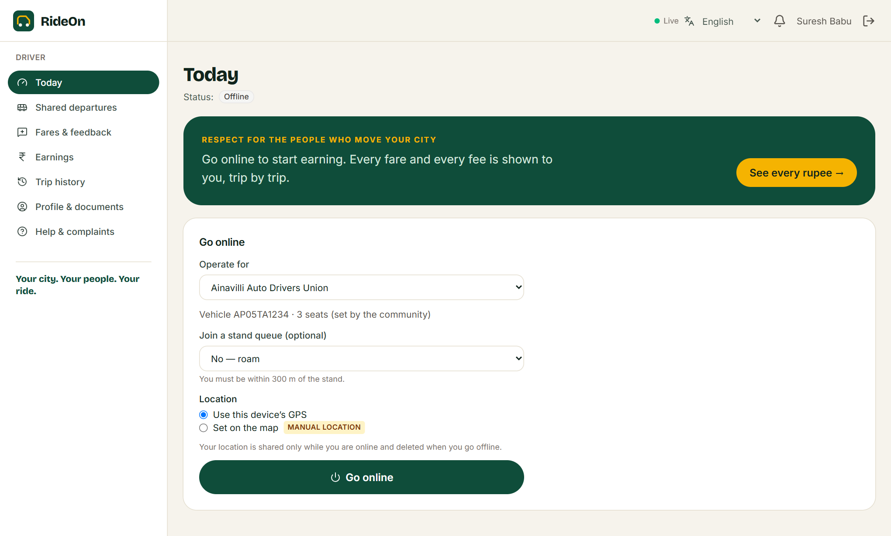

Your location is shared only while you are online, and it is deleted when you go offline. Keep the page open so you receive requests.

### Take a trip

Turns are fair: drivers queued at a nearby stand receive offers first, in the order they joined. After that, offers go to the nearest drivers.

1. A request appears under **Trip requests** with a countdown. Select **Accept** or **Decline**.
2. Drive to the pickup. The map includes a link for directions.
3. Select **I have arrived**.
4. When the passenger is in the auto, ask for their PIN, enter it in **Passenger's start PIN**, and select **Start trip**.
5. At the destination, select **Complete trip**.
6. For cash trips, take the fare and select **Confirm cash received**.

If several drivers accept, the first one wins and the others see that the trip was taken. If the passenger doesn't come, you can select **Passenger no-show** after waiting 5 minutes.

The fare is approved by your union and can't be edited. Select **Go offline** when you finish.

### Run a shared departure

1. Open **Shared departures**.
2. Under **Open departures you can take**, select **Take this run**. Your vehicle's seat count must cover it.
3. Under **My departures**, open the departure to see passengers by stop.
4. Select **Open boarding**. Enter each passenger's 4-digit PIN to board them, or mark a no-show.
5. Select **Depart**, drop each passenger at their stop, and record any cash.
6. Select **Complete trip**.

If the route changes or there is a delay or breakdown, select **Report deviation**.

### See your earnings

**Earnings** shows every rupee for the month you choose: today's net, month fares, platform and community fees, and your net earnings, day by day.

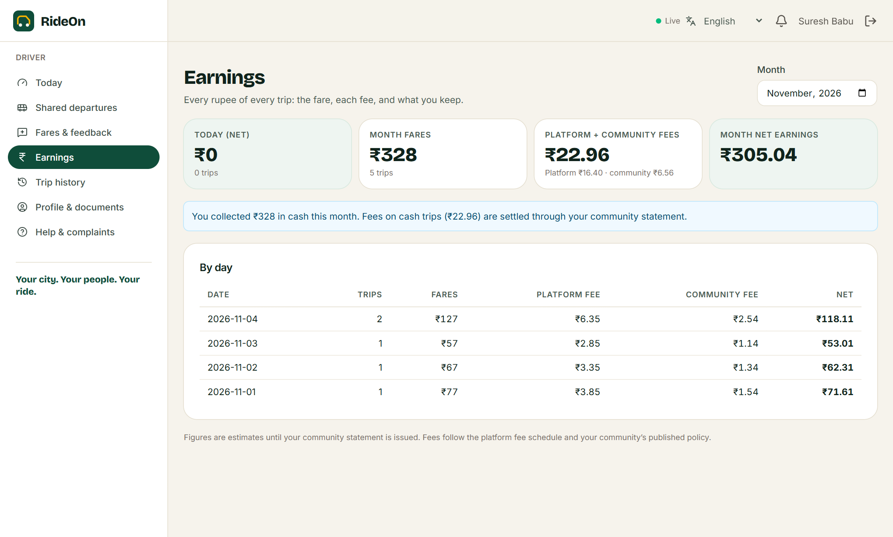

**Trip history** lists your past trips.

### Tell your union about fares

1. Open **Fares & feedback** to see your union's current fares.
2. Under **Give feedback**, choose **Which fare?**.
3. Choose **Too low**, **Fair** or **Too high**.
4. Optionally suggest a price, then **Tell your union why**.
5. Select **Send to my union**.

Replies appear under **My feedback and replies**. You can send up to 5 a day.

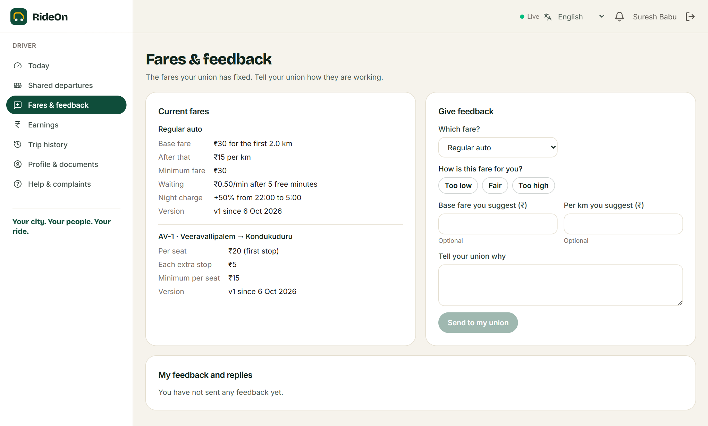

### Get help or appeal a decision

**Help & complaints** lets you ask a question, report an incident, or appeal a decision. Your union handles appeals first, and it can escalate them to the platform.

---

## 5. Operator guide

Operators keep the day running at the stand. RideOn opens your union console when you sign in.

### Live queue

**Live queue** shows drivers online for your union, on a map and in queue order at each stand.

To remove a driver from the queue, select **Remove** and enter a reason. The reason is recorded in the decision history, so use it only when needed.

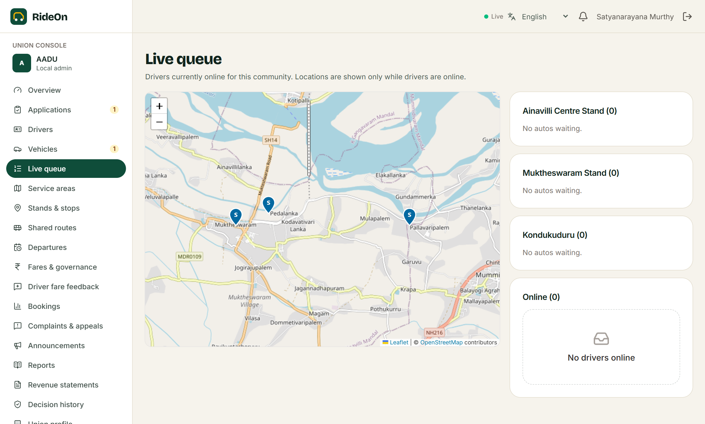

### Departures

**Departures** lists upcoming shared-auto runs. From here you can **Assign** a driver or **Cancel** a departure. Passengers on a cancelled departure are told and any prepaid amounts are refunded.

### Bookings

**Bookings** shows your union's trips and their statuses.

### Complaints and appeals

**Complaints & appeals** holds passenger complaints and driver appeals. Open one, update its status (for example, to in review or resolved), add your response and select **Save**. A safety complaint also alerts the platform, and you can escalate a case you can't settle.

---

## 6. Approver guide

Approvers make sure fares and rules change only by a fair vote.

### Vote on a proposal

1. Open **Fares & governance**. The badge shows how many proposals are waiting.
2. Under **Proposals**, review the title, the reason, and the before and after values.
3. Add a **Comment**, then approve or reject.

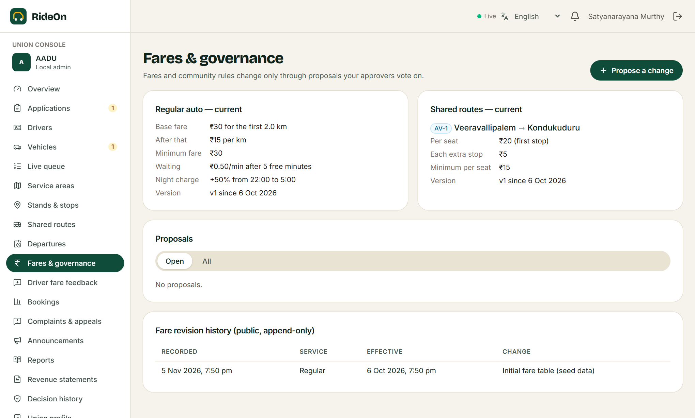

Good to know:

- **One rejection stops a proposal.** Any approver's rejection rejects it.
- **You can vote once** on each proposal.
- **You usually can't approve your own proposal.** Your union's rules decide this.
- **Large increases go to the platform as well.** An increase above your union's limit needs platform review after your vote.
- **Existing bookings are safe.** A booking keeps the fare it was made with, and the change begins at the published time.

Every approved change is added to the public **Fare revision history**, which can't be edited.

### Answer driver fare feedback

1. Open **Driver fare feedback**. It shows what drivers said and any price they suggested.
2. Select **Reply** on a feedback item.
3. Write **Your reply** and select **Send reply**. The driver sees it in their console.

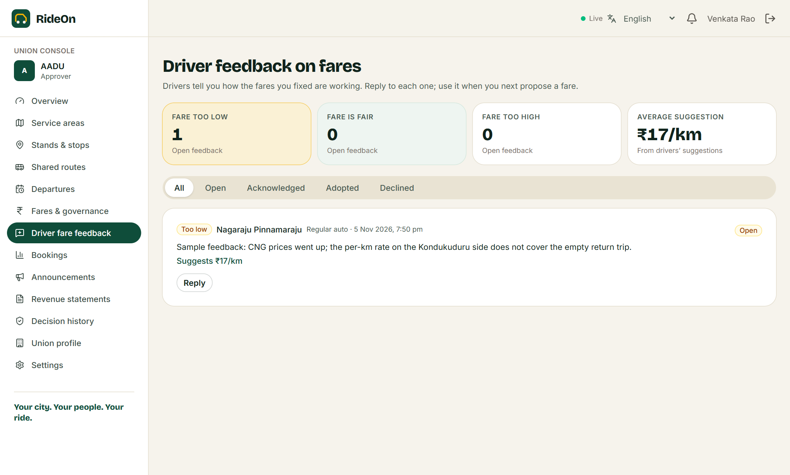

Use this feedback when your union next proposes a fare.

You can also view **Bookings**, **Revenue statements** and **Decision history**.

---

## 7. Reporter guide

Reporters prepare the union's figures, approve new drivers and keep the service area correct.

### Prepare a report

1. Open **Reports** and select **New report**.
2. Enter a **Title**, such as "October members' meeting", and the **From** and **To** dates.
3. Select **Prepare report**. You'll see trips, fares, union fund, drivers, cancellations, complaints, fare feedback and the busiest pickup point.
4. Write your **Notes** and select **Save notes**.
5. If the data has changed, select **Refresh figures**.
6. When it's ready, select **Publish** and confirm.

Publishing freezes the title and figures. You can still edit the notes. Use **CSV** to download a report. Only drafts can be deleted.

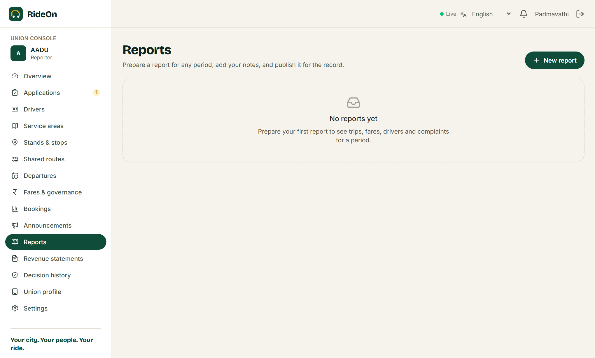

### Approve new drivers

1. Open **Applications**. The badge shows how many are waiting.
2. Review the application and approve or reject it. You must give a reason when rejecting or suspending.
3. Open **Drivers**, then **Documents**, to **Approve** or **Reject** each document.

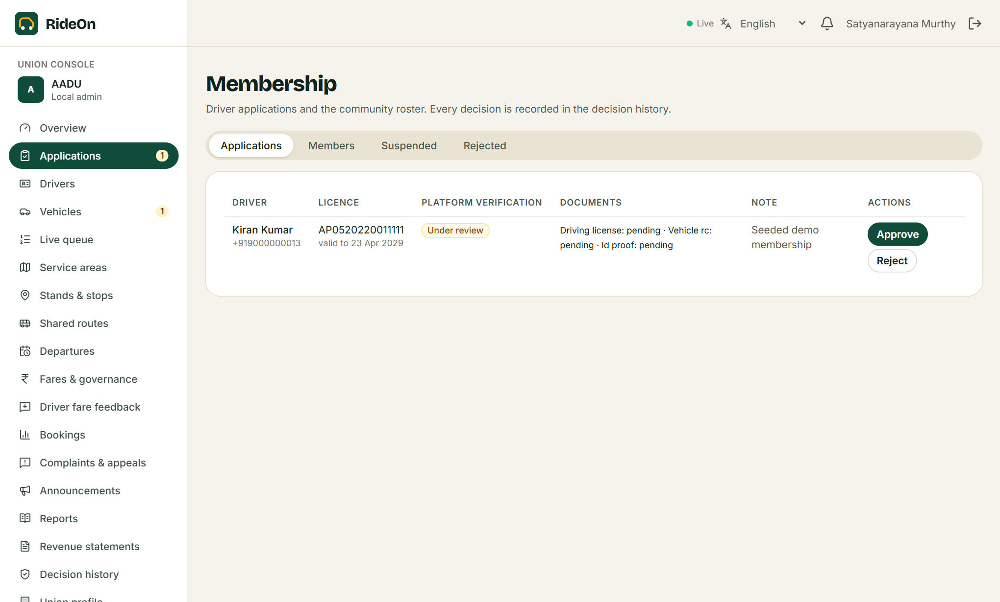

Every decision goes into the decision history, and every document view is logged.

### Set service areas

Passengers can be picked up only inside an active service area.

1. Open **Service areas**.
2. Draw the area by clicking points on the map. Use **Undo** or **Clear** to correct it.
3. Select **Save area**.

You can also view **Bookings**, **Revenue statements** and **Decision history**.

---

## 8. Local admin guide

Local admins run the union. You can do everything in the operator, approver and reporter guides, plus the tasks below. You only ever see your own union.

### Your first day checklist

1. Fill in the **Union profile** and logo.
2. Draw your **Service areas**.
3. Add your **Stands & stops**.
4. Propose your first **fares** and have them approved.
5. Add **Shared routes** and departure times, if you run them.
6. Give your team roles under **Team & permissions**.
7. Approve your drivers and vehicles.

### Union profile

**Union profile** holds your master data: name, short name, tagline, description, address, pincode, founded year, colour and contact details. Select **Save union details** to save it.

For a logo, upload a PNG or JPEG of up to 1 MB. Your details appear on the public fares page and in your drivers' app.

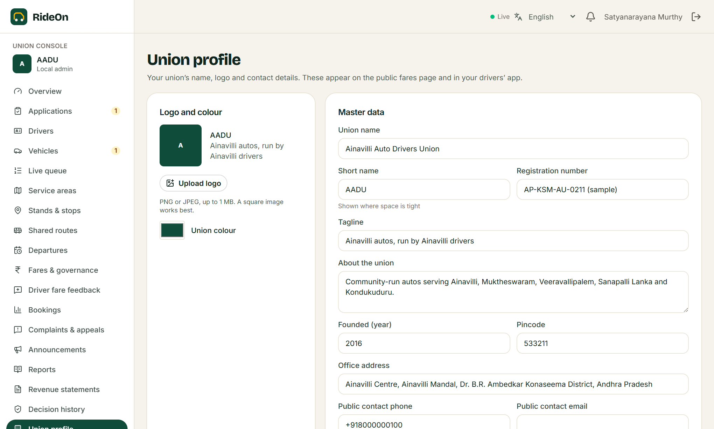

### Team and permissions

1. Open **Team & permissions**.
2. Enter the **Mobile number of a registered person**. They must have an account first.
3. Choose a **Role**: Reporter, Approver or Operator.
4. Select **Assign role**.

To fine-tune someone's access, select **Edit access**, tick **Choose individual permissions**, make your changes, and select **Save access**. **Remove** ends their access.

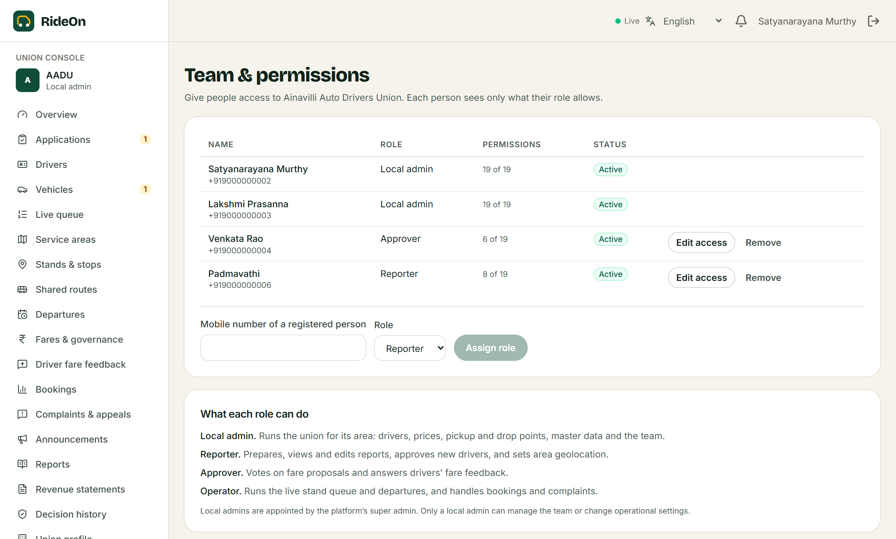

Managing the team and changing operational settings always stay with local admins and can't be delegated. Only the super admin can appoint another local admin.

### Stands, stops and routes

- **Stands & stops:** add a point, and mark it as a stand if drivers queue there. **Stops** are used by shared routes.
- **Shared routes:** select **New route**, add stops in order, then **Create route**. Use **Add departure time** for its schedule. A route can be activated only once it has an approved fare.
- **Deleting:** you can delete points, routes, schedules and announcements only when they aren't in use and have no history. Otherwise, deactivate them, which keeps the records.

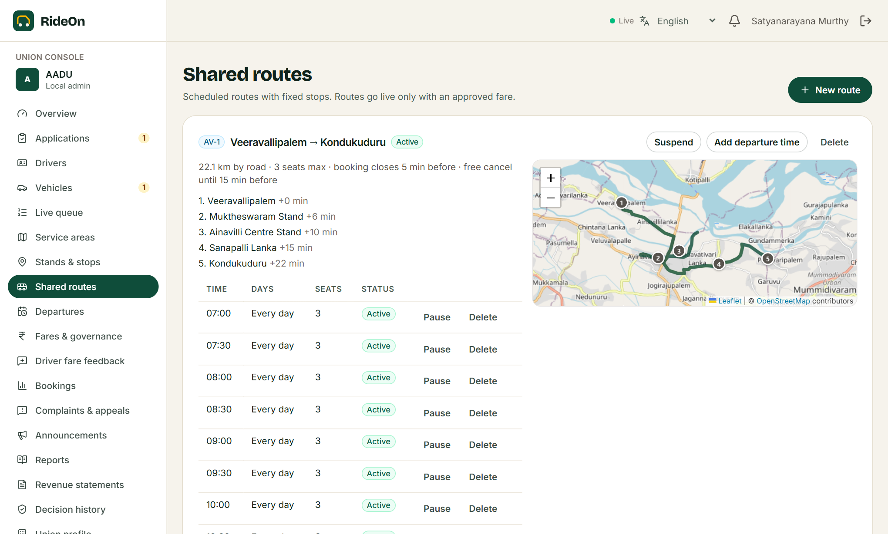

### Vehicles

**Vehicles** lists registrations waiting for you. When you approve one, you set its seat capacity, which should follow the vehicle's permit. Drivers can't change it.

### Change a fare

Fares change only through a proposal, never by direct editing.

1. Open **Fares & governance** and select **Propose a change**.
2. Choose the **Service**. For a shared auto, also choose the route.
3. Enter a **Title**, **Rationale** and **Effective from** date.
4. Enter the new values:
    - **Regular auto:** base fare, base distance, per km, minimum fare, waiting charge and free waiting minutes.
    - **Shared route:** per seat, each extra stop and minimum per seat.
    - **Both:** night surcharge and night hours.
5. Submit it. Your approvers then vote. See the [Approver guide](#6-approver-guide).

Proposals must stay within the platform's fare caps, and only one proposal per service can be open at a time. You can withdraw your proposal while it's still pending.

### Settings and rules

**Settings** has two kinds of setting:

| Kind | Examples | How to change |
|---|---|---|
| **Operational settings** | Driver offer timeout, booking request timeout, shared seat hold | Change and save them directly. The change is recorded |
| **Governed rules** | Fare approval mode, approvals required, self-approval, notice period, free cancellation window, cancellation fee | Select **Propose a rule change**. It takes effect only after an approved vote |

### Announcements, statements and history

- **Announcements:** publish a message to drivers (also sent as a notification) or passengers (shown on the public fares page).
- **Revenue statements:** see platform and community fees on completed trips, and export bookings as CSV. The platform issues statements.
- **Decision history:** a permanent record of every administrative action in your union. Nobody can edit or delete it.

---

## 9. Super admin guide

The super admin runs the platform and can see and change everything in every union. Every action is recorded.

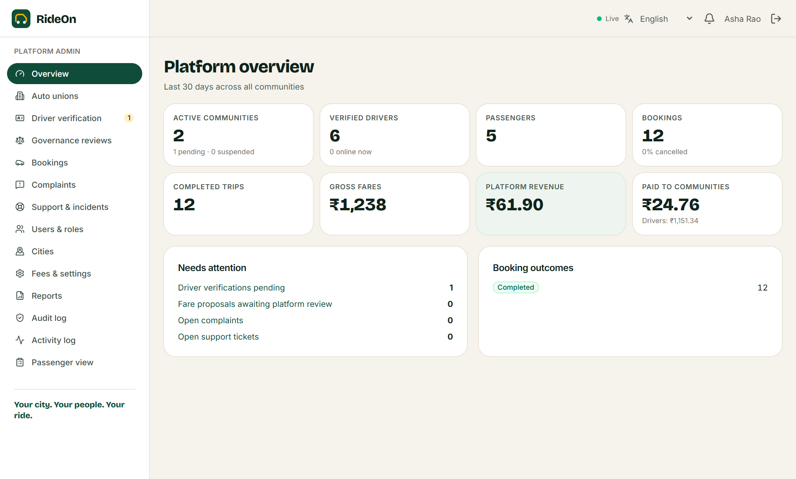

### Add a union and give it access

1. Open **Auto unions** and create a new union, placing its centre on the map. Select **Create union**.
2. Activate it when it's ready. You can also suspend or deactivate a union later.
3. Select **Give access** and enter the local admin's mobile number. They now have their own console and can set it up themselves.
4. Set the union's platform limits, such as the maximum fare increase before platform review.

A union with no bookings can be deleted. Otherwise, deactivate it.

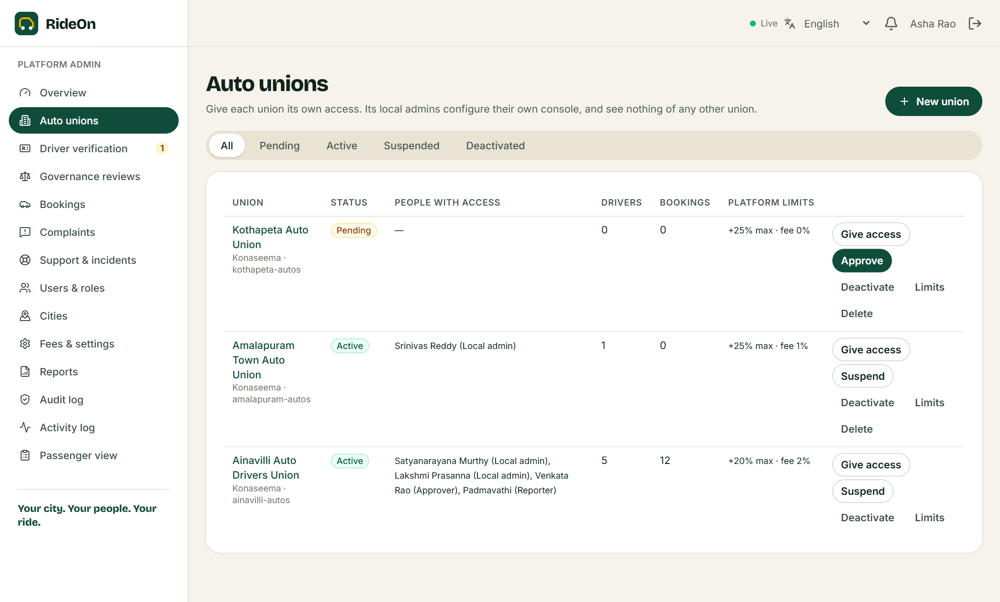

### Manage people and roles

Open **Users & roles** and search by name, phone or email. Select **Manage roles** to:

- Set platform roles.
- Assign or remove a union role, by choosing the **Union** and **Role** and selecting **Assign union role**.
- Suspend or reinstate an account. Suspending signs them out everywhere immediately.

You can't remove your own super admin role, and the last super admin is protected.

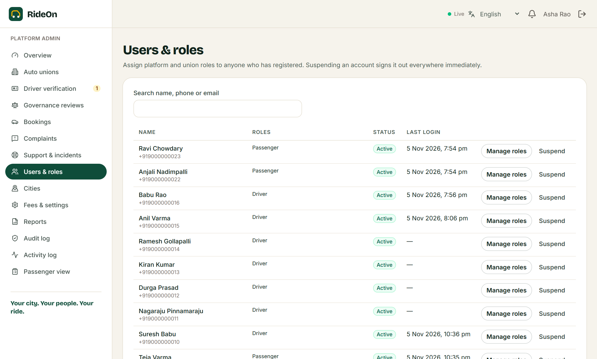

### Verify drivers

Open **Driver verification** and select **Review** on a driver. Approve or reject each document, then select **Mark verified** or **Reject**. This platform check covers identity and licence. Each union separately approves membership and vehicles.

### Review governance

**Governance reviews** lists proposals needing platform review: large fare increases, or unions that opted into review. Choose **Approve** or **Reject**. The union's own votes still apply.

### Fees and settings

Open **Fees & settings** to:

- Set **fare caps** that apply to all unions, then select **Save caps**.
- Plan platform fee changes for each service type with **Schedule fee change**.
- Turn feature flags on or off.

**Cities** holds the cities and districts that unions operate in.

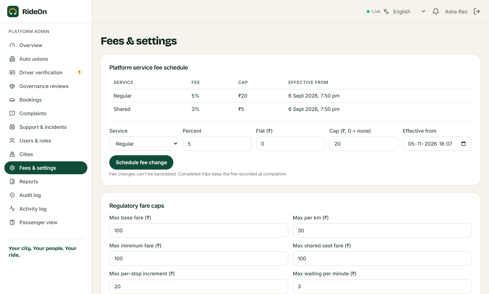

### Oversight

| Page | Use it to |
|---|---|
| **Overview** | See platform figures and what needs attention |
| **Bookings** | View all bookings |
| **Complaints** | View complaints across unions and decide escalated appeals |
| **Support & incidents** | Handle tickets. Safety tickets and SOS alerts are marked urgent |
| **Reports** | See 30-day figures, **Export bookings CSV**, and **Issue community statement** |
| **Audit log** | Read the permanent record of decisions. The database blocks changes to it |
| **Activity log** | See who did what on the site, for the last 90 days |
| **Passenger view** | Use the app as a passenger |

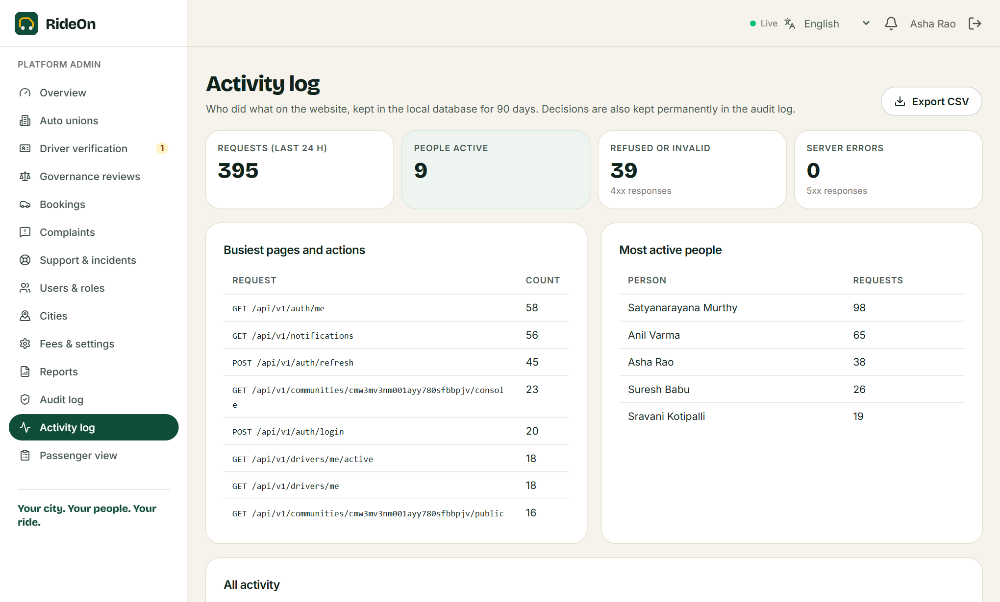

> The activity log contains personal data such as who visited which page, and from which IP address. Open it only when you need it, and cover it in your privacy notice.

---

## 10. Troubleshooting

| Problem | What to do |
|---|---|
| "Too many requests" | Wait up to 15 minutes, then try again. Reloading many times can trigger this |
| Account locked | Wait 15 minutes after 5 wrong passwords, or reset your password |
| No fare for my trip | Your pickup may be outside every service area. Choose a pickup inside your union's area on the **Fares** page |
| "Distance estimated" on my fare | The road routing service was unavailable, so distance was estimated. The fare is still the one shown |
| No driver available | No eligible driver was nearby or accepted. Try again shortly, or check **Shared autos** |
| The fare has expired | Quotes last 10 minutes. Select **See fare** again |
| The departure is full or closed | Seats have sold out or booking has closed. Choose another departure |
| Wrong start PIN | Ask the passenger to read it again from their trip page |
| Driver can't go online | Check **Ready to drive?** under **Profile & documents**, which shows the exact reason. Then check for expired licence, permit or insurance dates |
| Driver gets no offers | Keep the page open, check the status is online, and check your location is on and up to date |
| Can't join a stand queue | You must be within 300 m of the stand |
| A menu item is missing | Your role or permissions don't include it. Ask your local admin |
| "You are not an administrator of this community" | You don't have a role in that union. Ask your local admin or the super admin |
| Can't delete a point or route | It's in use or has history. Deactivate it instead |
| A rule won't save directly | Governed rules need an approved vote. Select **Propose a rule change** |

---

## 11. Glossary

| Term | Meaning |
|---|---|
| **Union / community** | Your local auto drivers' association |
| **Stand** | A place where drivers queue and take turns |
| **Stop** | A point on a shared route |
| **Shared auto** | An auto on a fixed route where you book seats |
| **Departure** | One scheduled run of a shared route |
| **Start PIN** | A 4-digit code you give your driver to begin the trip |
| **Hold** | Seats kept for you for a few minutes until you confirm |
| **Proposal** | A requested change to a fare or rule, decided by votes |
| **Platform fee** | The service fee RideOn takes on a completed trip |
| **Community fee** | The amount that goes to your union's fund from a completed trip |
| **No-show** | A passenger who didn't come to the pickup or stop |
| **Appeal** | A driver's request to review a decision about them |
| **Decision history / audit log** | The permanent record of decisions, which can't be changed |
