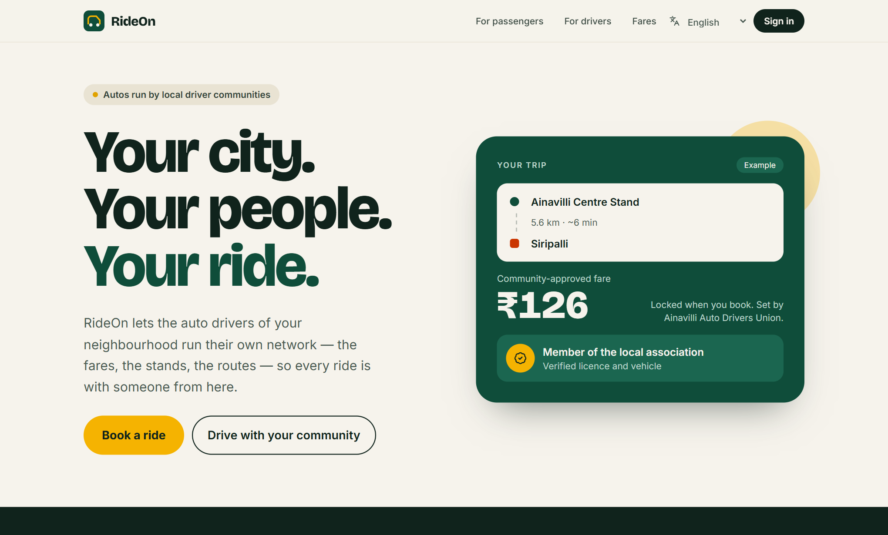
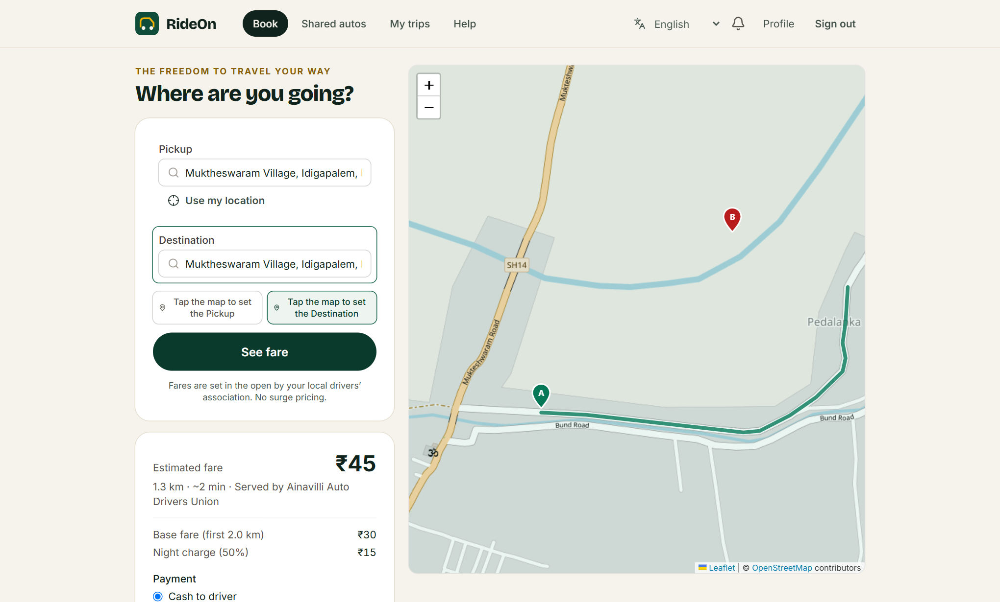
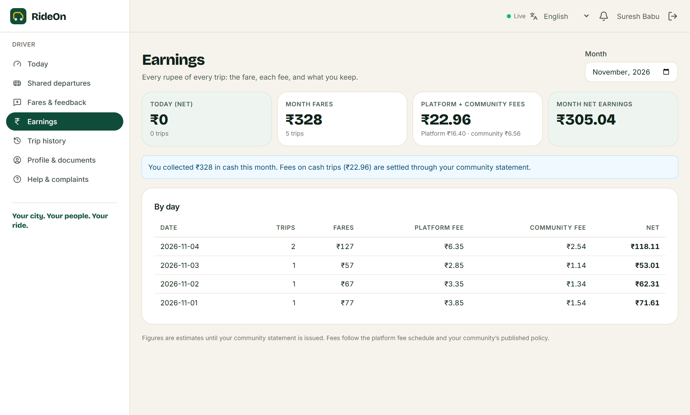
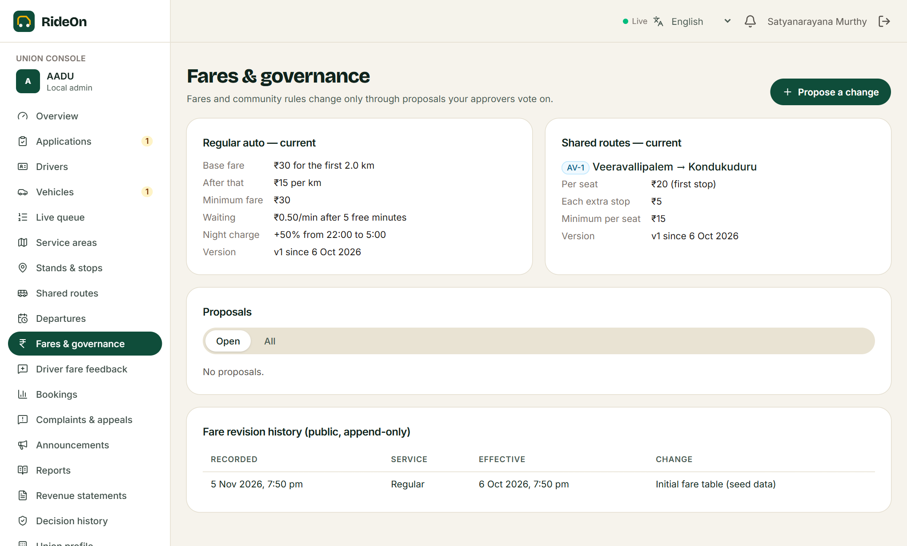
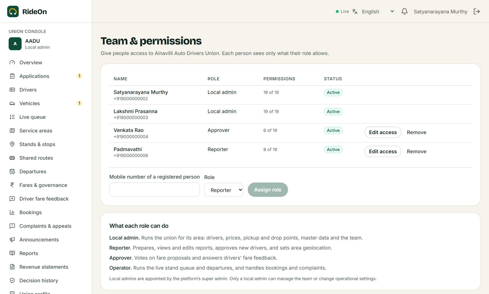
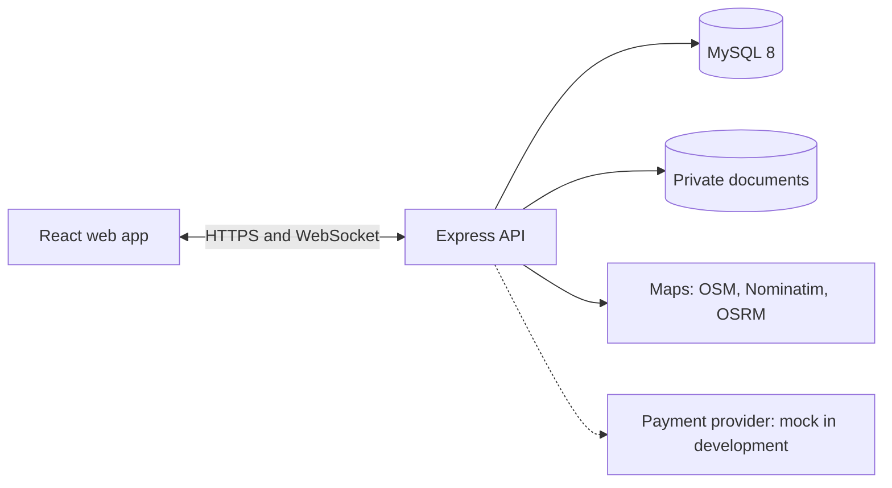

# RideOn

### Your city. Your people. Your ride.

**The auto-rickshaw booking platform run by local driver unions.** Unions set their own fares by recorded vote and manage their own members, stands and routes. RideOn provides the booking, maps, verification, records and support.




| Get started | Learn more |
|---|---|
| [Run it locally](#quick-start) | [Technical documentation](Documentation/Technical-Documentation.md) |
| [Try the demo accounts](#demo-accounts) | [User manual by role](Documentation/User-Manual.md) |
| [See what's working](#project-status) | [Marketing presentation](Documentation/RideOn-Marketing-Presentation.pptx) |

## Why RideOn

| | The promise | What it means in the product |
|---|---|---|
| **Passengers** | The freedom to travel your way | A whole auto or one seat, a fare shown and locked before you go, a start PIN, trip sharing and an emergency button, in Telugu, English or Hindi |
| **Drivers** | Respect for the people who move your city | Fares from your union and not an algorithm, every rupee shown per trip, first-come turns at the stand, recorded decisions and appeals |
| **Unions** | Your network, your rules | Your own console, name and logo, your own team and permissions, fare votes, reports and a permanent decision history |

The primary service area is **pincode 533211: Ainavilli mandal, Dr. B.R. Ambedkar Konaseema district, Andhra Pradesh**.

## See it

| Book with a locked fare | See every rupee |
|---|---|
|  |  |

| Govern fares by vote | Run your own team |
|---|---|
|  |  |

Screenshots use sample data. Union names, people and fares are placeholders.

## Features

**Passengers**
- Regular autos with server-priced, line-by-line quotes, and shared-auto seats on scheduled routes
- Live tracking, start PIN, trip sharing, emergency alerts, ratings and complaints

**Drivers**
- Licence and document upload, union application, and a clear "ready to drive" check
- Stand queues, live trip offers, PIN start, shared departure manifests
- Earnings with every deduction, and fare feedback to the union

**Unions**
- Delegated roles with per-person permissions
- Service areas, stands, stops, routes and schedules on a map
- Fare and rule proposals, votes, versioned publication and a public history
- Master data and logo, reports, statements, complaints and appeals

**Platform**
- Union onboarding, driver verification, fees, fare caps and role assignment
- Append-only audit log and a 90-day activity log of every API request

## Roles

| Role | Scope | Can do |
|---|---|---|
| **Super admin** | Platform | Assign platform and union roles; update or delete configured data; every union permission in every union |
| **Local admin** | One union | Approve drivers; propose fares; add or delete pickup and drop points; edit master data; give roles and permissions to people below them |
| **Reporter** | One union | Prepare, view and edit reports; approve new drivers; set area geolocation |
| **Approver** | One union | Vote on fare proposals; read and answer driver fare feedback |
| **Operator** | One union | Live queue and departures; bookings; complaints |
| **Driver** | Own account | Run trips; see earnings; give fare feedback; raise tickets |
| **Passenger** | Own account | Book, track, pay, rate and complain |

Each person sees only the pages their permissions allow, and the API enforces the same rules. The [user manual](Documentation/User-Manual.md) has step-by-step guides for every role.

## Architecture



The API is the authority for every fare, seat and state change. Real-time updates are an enhancement, and every screen also polls. The [technical documentation](Documentation/Technical-Documentation.md) covers the full design, including 15 sequence diagrams.

| Layer | Technology |
|---|---|
| Web | React 19, TypeScript, Vite, Tailwind CSS 4, React Router 7, TanStack Query, React Hook Form with Zod, Leaflet, Socket.IO client |
| API | Node.js 24, TypeScript, Express 5, Zod, Prisma 6, Socket.IO, Argon2id, JWT with rotating refresh cookies, pino |
| Database | MySQL 8 |
| Tests | Vitest, Supertest, Testing Library, Playwright |

```text
apps/api        Express API, Prisma schema and migrations, seed, jobs, sockets, tests
apps/web        React app: public pages and four consoles, tests
e2e/            Playwright browser journeys on an isolated stack
Documentation/  Technical documentation, user manual, presentation
docs/           Architecture, database, API, security and deployment references
scripts/        Local MySQL start and stop helpers
```

## Quick start

**You need:** Node.js 24 or later, and MySQL 8.0 or later.

1. Install dependencies:

   ```bash
   npm install
   ```

2. Create your configuration:

   ```bash
   cp .env.example .env
   ```

   Edit `.env` to set `DATABASE_URL` and `TEST_DATABASE_URL`, and to generate the three secrets. The file explains how.

3. Create the schema:

   ```bash
   npm run db:migrate
   ```

4. Load the demo data:

   ```bash
   npm run db:seed
   ```

5. Start the API on port 4000:

   ```bash
   npm run dev:api
   ```

6. In a second terminal, start the web app on port 5173:

   ```bash
   npm run dev:web
   ```

7. Open http://localhost:5173.

### Windows portable setup

This repository was developed with a project-local Node.js and MySQL in `.tools/`, which is git-ignored and so isn't included when you clone. If you have the same setup, add `.tools/node` to your `PATH`, then start MySQL on `127.0.0.1:3307`:

```bash
sh scripts/db-start.sh
```

Stop it with `sh scripts/db-stop.sh`.

## Demo accounts

These exist only when you run the development seed, which refuses to run with `NODE_ENV=production`. All of them use the password **`Demo@12345`**. Never use these credentials anywhere else.

| Role | Mobile | Notes |
|---|---|---|
| Super admin | 9000000001 | Also a passenger |
| Local admin, Ainavilli | 9000000002, 9000000003 | |
| Approver, Ainavilli | 9000000004 | |
| Local admin, Amalapuram | 9000000005 | A different union, to show isolation |
| Reporter, Ainavilli | 9000000006 | |
| Drivers, Ainavilli | 9000000010 to 9000000012 | Verified, with trip history on 9000000010 |
| Driver applicant | 9000000013 | Pending approval |
| Driver, Amalapuram | 9000000014 | |
| Spare drivers, Ainavilli | 9000000015 (Anil Varma), 9000000016 (Babu Rao) | Ready to go online, no trip history |
| Passengers | 9000000020 to 9000000023 | 9000000022 and 9000000023 have no trip history |

In development, the login page opens prefilled with Anil Varma (9000000015). Press **Sign in**, or replace the values to use another account. Production builds leave the form empty.

Run `npm run db:seed` again to add the spare accounts to an already seeded database without losing anything.

### Try a full trip

1. Sign in as a driver. Choose **Set on the map**, place yourself in the Ainavilli area and select **Go online**.
2. In another browser profile, sign in as a passenger and book a ride inside the Ainavilli area.
3. Accept the request as the driver, then follow the trip through to **Complete trip**.

## Testing

MySQL must be running.

Run the API and web suites. The API suite migrates `TEST_DATABASE_URL` automatically and truncates it per test file:

```bash
npm test
```

Run the browser journeys. They use your installed Google Chrome and start their own database, API and web server, so development data stays untouched:

```bash
npm run test:e2e
```

**Latest recorded results (5 November 2026):** API 98 passed, web 16 passed, browser 18 passed; type check, lint and build pass.

## Scripts

| Command | What it does |
|---|---|
| `npm run dev:api`, `npm run dev:web` | Run the API or web app in watch mode |
| `npm run build` | Production build of both apps |
| `npm run typecheck` | Type-check both apps |
| `npm run lint` | Run ESLint over both apps and the browser suite |
| `npm test` | Run API and web tests |
| `npm run test:e2e` | Run browser journeys on an isolated stack |
| `npm run db:migrate` | Apply migrations |
| `npm run db:seed` | Load development demo data |
| `npm run db:reset` | Drop and recreate the dev database. **Destructive**, and Prisma asks for confirmation |

## Project status

RideOn is **pre-pilot and not yet production-ready.** The product works end to end with cash payment, and it hasn't yet run with real customers.

| Not done yet | Why |
|---|---|
| Real payment gateway | On hold by decision. A clearly labelled mock checkout is available in development |
| SMS and email delivery | On hold by decision. Notifications are in-app, and password reset codes can't reach users until a provider is added |
| Telugu review | The translation is machine-written and needs a native speaker's review |
| Docker Compose | Written but not yet run |
| Hosted map providers | Development uses public OpenStreetMap services, which aren't suitable for production traffic |

See the [build status](BUILD_STATUS.md) for the full list and the [production checklist](docs/security.md#production-checklist) before deploying.

## Documentation

| Document | For |
|---|---|
| [Technical documentation](Documentation/Technical-Documentation.md) | Developers and reviewers: SDLC, requirements, design, sequence diagrams, testing, operations |
| [User manual](Documentation/User-Manual.md) | Everyone who uses the product, by role |
| [Marketing presentation](Documentation/RideOn-Marketing-Presentation.pptx) | Unions, partners and supporters |
| [Architecture](docs/architecture.md) | Module layout and design decisions |
| [Database design](docs/database-design.md) | Tables and migrations |
| [API reference](docs/api-documentation.md) | Endpoints and conventions |
| [Security](docs/security.md) | Controls and production checklist |
| [Deployment](docs/deployment.md) | Build, release and scaling |
| [Build status](BUILD_STATUS.md) | Test results and known limitations |
